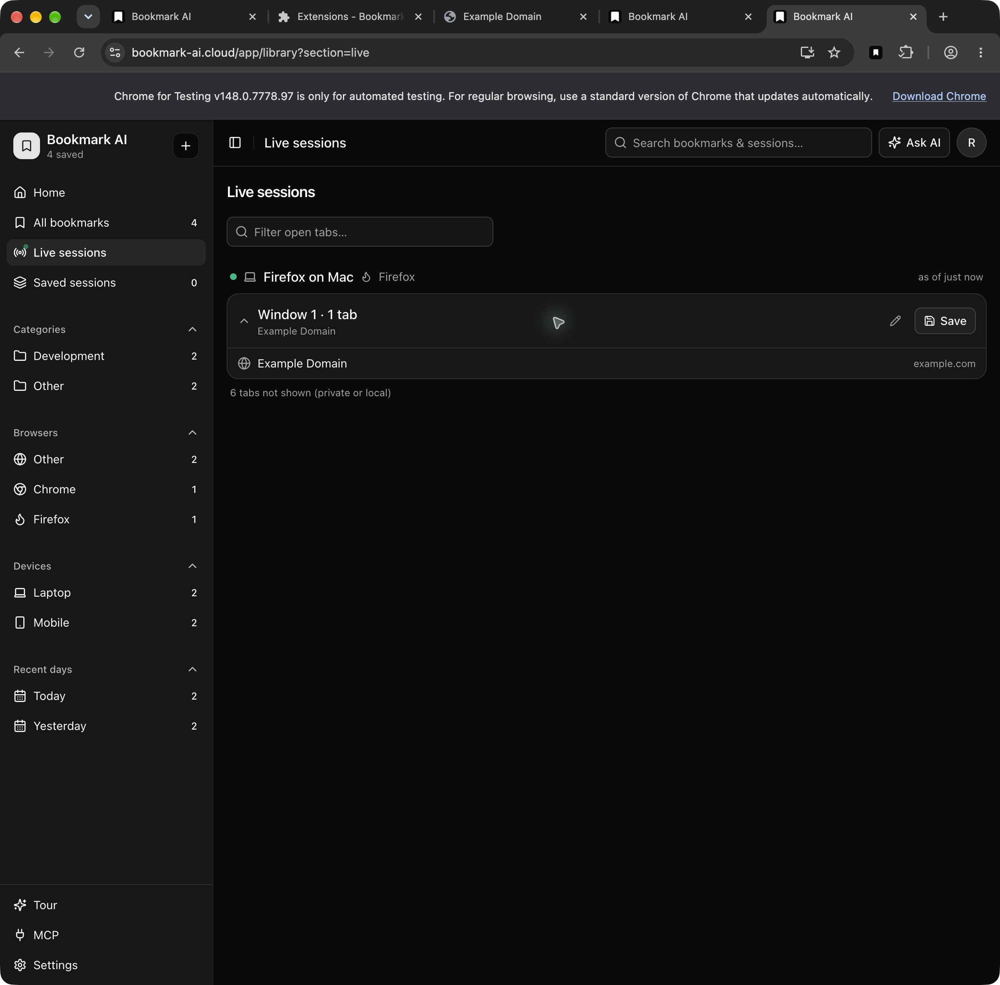

# Production clients — 9 October 2026

## Deliverables and identity

One package kit: `dist/production/`, with `INSTALL.md`, `ARTIFACTS.json` (extension/Mac/Safari source and file hashes) and `mobile-manifest.json` (mobile signing/package evidence). Ordinary extension outputs `apps/extension/.output/{chrome-mv3,firefox-mv2,safari-mv3}` match the kit bytes. Production defaults and zip aliases use `production:supabase`, explicit frozen Supabase production configuration, canonical API/Live URLs and separate `bookmark-ai:supabase-production` storage. Earlier QA clients/configuration and installed Apple bundles have rollback copies in `.work/production-oct9/`.

| Client | Production identity/version | Package/install |
| --- | --- | --- |
| Chrome | `ffhbgpgebpmofjkehpjcemepbgcmoelp`, 0.1.6 | kit `chrome/`, standard `chrome-mv3/`, `chrome.zip` |
| Firefox | `bookmark-ai@bookmark-ai.cloud`, 0.1.6 | kit `firefox/`, standard `firefox-mv2/`, `firefox.zip` |
| Safari | `ai.bookmark.safari` / `.Extension`, 0.1.6 (10600) | `/Applications/Bookmark AI for Safari.app`, kit same name |
| Mac | `ai.bookmarkai.macos`, 0.1.1 (8) | kit `Bookmark AI.app`; installed signed build 8 |
| Mobile | `ai.bookmarkai`, 1.0.2 (102) | signed IPA/APK/AAB and simulator zip; mobile agent's separate report |

Apple packages are signed local development releases, universal arm64/x86_64, sandboxed, with hardened runtime and no get-task-allow or native Apple-login entitlement. These are not claimed notarized, store-published or TestFlight builds. Firefox's local temporary add-on must be reloaded after restart; AMO publication remains separate.

## Tests and artifact checks

- Wrapper isolation/production: 13 tests passed.
- Extension: 251 tests across 29 files and TypeScript check passed.
- Native web callback protocol: 9 tests passed; full web typecheck passed. Optional validated `buildVariant` chooses fixed production callbacks, retains base database client types and QA defaults; no arbitrary callback URL is accepted.
- Live config: 6 tests passed. Root updated allowlist to retain all six QA/production public clients; existing deployed runtime marker was preserved.
- Mac: 219 tests passed, 13 known skips, including 5 new main-window lifecycle regressions. The skips cover opt-in visual cases and legacy-ticket cases under Supabase.
- Chrome, Firefox and Safari zip aliases passed.
- AMO reviewer source archive rebuilt using its included public configuration and locked dependencies: all 21 Firefox output hashes match exactly. No private environment/PEM or backend secret bytes were found; `amo-source-proof.json` records the archive hash and comparison.
- Official Mozilla `web-ext lint`: 0 errors, 0 notices, 11 `UNSAFE_VAR_ASSIGNMENT` warnings in bundled JavaScript. These warnings remain review evidence; a successful lint is not store approval.
- Hosted OAuth preflight: 3 tests passed (16 combined wrapper/preflight tests). Both client-ID and exact callback allowlists are independently required; QA IDs/callbacks are preserved. Quoted CSV is tested; a redacted environment download is explicitly unreadable and cannot pass. Root verifies the exact hosted promotion inputs and records deployment/runtime proof separately.
- Public artifact audit privately compares 10 backend credential byte values: no matches in browser packages or Apple app contents. Production public client present, QA client absent, production namespace present. Standard outputs and manifest hashes match. Generic inactive Clerk-host and QA port-3100 policy literals remain in shared JavaScript; active Supabase guards pin canonical origins and ignore stored custom endpoints. No localhost:3000 literal was found.

Evidence: `.work/production-oct9/{wrapper-tests,extension-tests,extension-types,native-callback-tests,web-native-types,live-config-tests,mac-single-window-tests}.log`, `extension-public-config-scan.json`, `apple-artifact-proof.json`.

## Mac single-window release gate

The installed production app was one process, but the unkeyed SwiftUI `WindowGroup` admitted multiple main scenes after URL return; repeated reopen requests could also call `openWindow` before a reader attached. The scene now has the fixed String identity `main`, used by the default and every open action, and external events prefer its existing scene. A pending-creation latch absorbs repeated requests. Only the main-scene reader registers main windows; stale restored duplicate main scenes are retired without closing Settings/auth windows. Closing the recognized main clears its reference; minimizing preserves it and Dock reopen deminiaturizes it. Automatic window tabbing is disabled.

Tests cover repeated reopen bursts before attachment, close/reopen one replacement, auxiliary close isolation, duplicate main-only retirement and app remaining available after the last window closes. Source review is independent. Signed build 8 is installed. Production browser handoff and session restart passed. Minimizing and returning preserved the same main-window ID; close and reopen retained one main entry. The Window menu showed exactly one All Bookmarks entry and a separate General entry while Settings was open. Direct Dock accessibility control timed out; the supported app-launch/reopen path exercised the same delegate instead.

## Runtime evidence and outstanding checks

Before the window fix, build 7 opened canonical production sign-in in default Chrome. An expired request was rejected and a fresh flow succeeded using the disposable fixture in a separate Chrome for Testing tab. The browser displayed the canonical Open Bookmark AI.app prompt; Mac showed the fixture account and library. The native exchange requires a completion code from the callback, so this proves a production callback reached the app, although the final prompt click was not attributable after the UI changed. Exact process path: `/Applications/Bookmark AI.app/Contents/MacOS/BookmarkAI`. Safari's worker now runs from the installed `/Applications/Bookmark AI for Safari.app/Contents/PlugIns/Bookmark AI Extension.appex/Contents/MacOS/Bookmark AI Extension`, after scoped duplicate registration cleanup. No global LaunchServices reset or owner browser logout was performed.

Chrome production 0.1.6 was loaded from the ordinary `chrome-mv3` folder in the explicitly approved prior QA profile; Details verified ID `ffhbgpgebpmofjkehpjcemepbgcmoelp`, version, enabled state and path. The initial real toolbar consent rejection exposed a missing hosted production callback. Root corrected the exact allowlist (six IDs/five callbacks, readable hosted preflight PASS) and promoted `dpl_B8qCYyGUSPgqVbuw5EpcnH8aa3fE`. The actual toolbar then reused the known fixture's existing web session with no password requested, displayed production consent, returned through the validated OAuth callback/token exchange, and rendered the exact fixture identity. Saving `https://example.com/?bookmark-production-chrome-oct9=1791535815975` through the popup passed: fresh canonical web reload increased the library from two to three bookmarks and displayed that exact URL labelled Mac · chrome. Live and native sync remained off. `chrome-production-runtime-proof.json` records this PASS. Only the isolated profile's web session was previously changed locally; no global revoke or owner bookmark mutation occurred.

Firefox production was installed by Mozilla's official `web-ext` runner in a new isolated `.work/production-oct9/firefox-production-profile`; runner log confirms the exact standard production source directory and successful temporary install. Native CUA app binding by both exact app path and bundle ID returns server `-10005: timeoutReached` after approximately 5 seconds; inventory confirms Firefox running, with no supported Firefox browser connector. The mobile agent subsequently completed production Firefox authentication/save through Mozilla’s official isolated WebDriver/Marionette alternative: actual toolbar popup keyboard Sign In launched canonical authorization, fixture login/consent completed the real callback, and an explicitly approved full-tab popup view saved a unique owned URL. Canonical web and API confirmed exactly one row. [Detailed Firefox evidence](2026-10-09-firefox.md) distinguishes the actual toolbar auth from full-tab save and records limitations. No Live action occurred. Safari’s earlier attempted launch remains unattributable; current authenticated state is described below. Mac build-8 lifecycle and session restoration passed through supported app surfaces as described above. Test accounts and their saved fixtures are retained at the user’s request. Client fixture sessions will be signed out after the authorized checks, preserving preexisting owner sessions. Chrome’s individual runtime gate and the canonical web recovery gate now pass; Firefox’s authentication/callback/save gate now passes; the approved shared Live OFF correction is now deployed as compiled server SHA256 `72eb0b5f1f93fc45cee9f543e1ae0b3d134ace2848dca06c1d5c8070f7a3ee64`, with actual Chrome OFF / Firefox continuation acceptance passed as detailed below. Store uploads/submission status is recorded separately.

Safari initially loaded the old legacy reconnect popup even though installed 0.1.6 resources matched the production hashes. `pluginkit` revealed a second registration from the preserved September 20 Xcode archive 0.1.4. Only that exact archived app registration was removed (archive bytes preserved); one intended `/Applications/Bookmark AI for Safari.app` production plugin remains. Safari Settings then verified 0.1.6 from the intended companion with its existing enabled checkbox. Normal “Quit and Keep Windows”/reopen restored the actual Supabase popup; no AllowUnsigned, website permissions or other protection was changed. The first attempted Sign In click was blocked before execution because the display was locked. After the user unlocked the Mac, the actual production toolbar Sign In was clicked twice; the popup dismissed, but no authorization tab or window appeared. Dismissal alone is not success evidence because Safari can dismiss popovers on focus changes. Read-only source review verifies the popup waits for a successful START_OAUTH reply, and the background creates a blank tab, persists PKCE/state and then updates it to the canonical authorize page. Later read-only inspection found the exact production toolbar authenticated to an existing owner-like account with Live on, following user activity. Its background inspector was loaded and the current scoped OAuth diagnostics were empty; the in-memory ring resets on worker boot and cannot prove the earlier flow. The inspector was closed without changing credentials, Live, permissions or bookmarks. No fresh fixture callback or save success is claimed, and the existing account was preserved. Firefox’s CUA timeout persisted after unlock, so it is not attributed to display lock.

Build-8 fresh production handoff displayed the fixture account and both mobile test bookmarks; exact active production process path remained `/Applications/Bookmark AI.app/Contents/MacOS/BookmarkAI`. After a full quit and relaunch, the fixture session restored without signing in again. Browser-return replay checks exercised window routing while preserving authentication state; they are not additional fresh token-exchange proofs.

## Approved Live correction and store follow-through

Read-only tracing found the original shared OFF branch called account-wide settings; it was unchanged from the Clerk implementation and affected all three browsers. The user explicitly approved a backend correction. Independent source review passed: trusted verified extension session identity selects the own publishing fence, and Redis Lua combines stop/admission checks with snapshot mutation and event publication. OFF preserves siblings, account opt-in and independent device preferences. A stale pre-OFF write after explicit ON is acknowledged without committing or sending a stop response; a truly stopped client still receives403. First-party account-wide OFF remains separate. Root's isolated real-Redis integration log records11 passed,0 failed, covering full/no-op/heartbeat/encryption migration races, OFF→ON, ownership, mutation failure and AOF restart. Provider verification/account lookup were simulated in these local integration tests. An already-sent genuine403 can still arrive after a later ON; no claim is made that the backend changes arbitrary client response ordering. No extension/package bytes changed or required rebuilding.

After deployment, actual Chrome OFF / Firefox sibling acceptance **passed**. Exact loaded production hashes/profile and the normal revealed fixture email were checked for both isolated browsers. Chrome's real toolbar switch and Firefox's approved normal full-tab popup control enabled Live; the canonical viewer showed both clients. Chrome's actual toolbar switch was then turned OFF and became enabled again after the request settled. Chrome disappeared from the viewer while Firefox remained. Root subsequently opened the owned Firefox URL `https://example.com/?qa-live-sibling-oct9=1791548076824`; the canonical viewer displayed that exact new link in Firefox's live window, with no Chrome card and all four saved fixture bookmarks intact. This is actual unchanged-client publication after sibling OFF; delayed push/epoch races are covered by the separate real-Redis tests, not inferred from this UI check. Safari owner credentials, tabs, saved data and Live setting remain unchanged. Chrome remains OFF. The first scoped Firefox cleanup timed out waiting for its mounted OFF control; existing popup views were stale because the local setting is read only on mount. A fresh normal popup then verified the exact fixture identity and a stable, enabled OFF switch without another toggle. The exact owned navigation tab and only the newly created cleanup popup were closed. Both fixture Live switches are restored OFF; accounts and saved bookmarks are retained.

Evidence: `.work/production-oct9/live-firefox-sibling-proof.json`, `live-chrome-off-firefox-continues.ax.txt`, `live-chrome-off-firefox-continues.png`. The attached driver uses only the approved Firefox profile. A child-agent loopback bind failed despite root's full-access environment, so root ran the exact bounded helper. An earlier Python HTTP probe returned non-JSON403 outside the application's JSON auth response; it is not labelled an application auth failure. The final acceptance uses normal UI identity verification and public tab updates, with no token injection, route/User-Agent workaround or security protection change.

Chrome0.1.6 was **submitted** by root to the exact existing item and is pending review, with automatic publication selected. Root recorded the confirmation/status receipt; this is not approval or publication. Firefox AMO remains at Mozilla publisher sign-in and has not been submitted. [Store receipts and exact status](2026-10-09-extension-stores.md) are recorded separately. Root owns both portals because the child browser connector does not expose its in-app browser. Local store-credential name checks found no AMO/WEB_EXT/MOZILLA/CWS names in the known root/extension environment files or inherited environment; remote GitHub secret names could not be verified due API connectivity.
