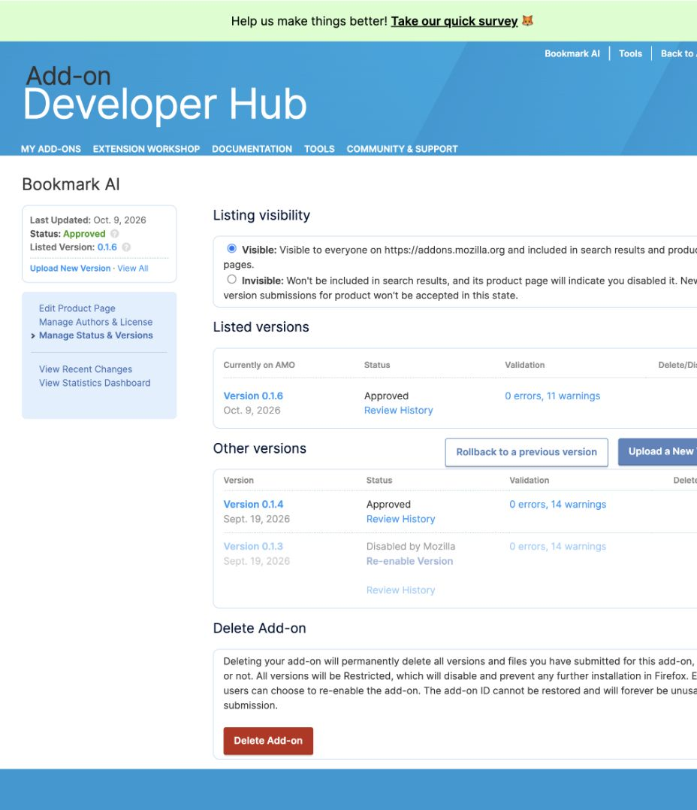

# Extension store receipts — 9 October 2026

## Chrome Web Store

- Public item ID: `ffhbgpgebpmofjkehpjcemepbgcmoelp` ([listing](https://chromewebstore.google.com/detail/bookmark-ai/ffhbgpgebpmofjkehpjcemepbgcmoelp)).
- Submitted version: **0.1.6**, exact `dist/production/chrome.zip` production artifact.
- Current status, verified October 10: **PUBLISHED / publicly available — 0.1.6**. Root observed version 0.1.6 on the exact public Chrome Web Store listing above. Signed-store installation/restart is a separate pending runtime check.
- Submission history, October 9: root observed the confirmation modal and developer-portal pending-review status, with automatic publication selected. That earlier receipt established submission; the October 10 public-listing observation establishes availability.
- Store description accurately states separate Supabase extension authentication and free credits. Identity/host/storage permission justifications were updated; the 478-character reviewer instructions were saved.
- Retained machine-local receipt: `.work/production-oct9/chrome-016-submitted.png`. Private publisher credentials and reviewer account details are excluded from this report.

## Firefox AMO

- Public add-on GUID: `bookmark-ai@bookmark-ai.cloud`; listing: [bookmark-ai-cloud](https://addons.mozilla.org/en-US/firefox/addon/bookmark-ai-cloud/). The retired `bookmark-ai` / `@purecode.ai` listing was not used.
- Final status: **APPROVED / PUBLISHED — 0.1.6**. Root verified the public listing shows version **0.1.6**, updated **October 9**, and the publisher's manage-versions page shows **Currently on AMO: Version 0.1.6 — Approved**. The live signed download is [bookmark_ai_cloud-0.1.6.xpi](https://addons.mozilla.org/firefox/downloads/file/5102872/bookmark_ai_cloud-0.1.6.xpi).
- Submission history: root first observed `/versions/submit/6558734/finish`, then [version 6558734](https://addons.mozilla.org/en-US/developers/addon/bookmark-ai-cloud/versions/6558734) Awaiting Review, file **5102872**. It subsequently moved to Approved and replaced public version 0.1.4 during the same release run.
- Uploaded package SHA256: `aedda812debdf1b981124f2eb5817bfd080c15af55ccd8952f1877da8952ec29`.
- Matching source archive SHA256: `36c8096b1ef1f28c56dd9e75bc1c4afba8444786c094339d46836c1c74131358`. Root uploaded it through the source step and confirmed the current source link `/firefox/downloads/source/6558734`. Its `BUILD.md` and public build configuration previously reproduced all 21 Firefox output hashes exactly.
- Server validation: **0 errors, 11 warnings**. The warnings remain retained review evidence; approval/publication is established by the separate portal and public-listing observations above.
- Root verified the updated public description states independent Supabase extension authorization, included free credits and optional Firefox usage analytics.
- Root also saved the AMO privacy field, replacing stale shared-session wording with Supabase independent authorization, required bookmark/browsing/device data, consent-gated PostHog usage analytics, operational diagnostics and the canonical privacy link; the portal confirmed “Changes successfully saved,” with license/authors unchanged.
- The AMO-hosted privacy policy was also updated and verified publicly: Supabase replaces the old Clerk/shared-session wording, with the required data categories, consent-gated PostHog analytics, operational diagnostics and the canonical service policy link. Existing authors and the MIT license were unchanged.
- Receipts: `.work/production-oct9/firefox-016-approved.png` and `.work/production-oct9/firefox-016-submitted.png`. The safe approval screenshot is preserved below; the [earlier submission receipt](assets/2026-10-09-firefox-016-submitted.png) is retained as history. Public signed-XPI installation/restart was not rerun after publication.

## Runtime boundary

Chrome and Firefox production auth/callback/save checks passed as recorded in the [client report](2026-10-09-clients.md); Firefox's full-tab save is distinguished from toolbar authentication. The [Live backend correction](2026-10-09-live-tabs.md) is deployed with 72/72 backend tests passed and health/auth smoke passed. Actual post-deployment Chrome OFF / Firefox continuation **passed**: the real Chrome toolbar OFF removed only Chrome, and the canonical viewer displayed Firefox's subsequent new owned tab. Safari's owner session was preserved; no fresh Safari fixture OFF/ON claim is made. Store submission does not upgrade pending browser, physical-device, provider or PWA cases to PASS. Apple and Google Play submissions are outside these receipts.
