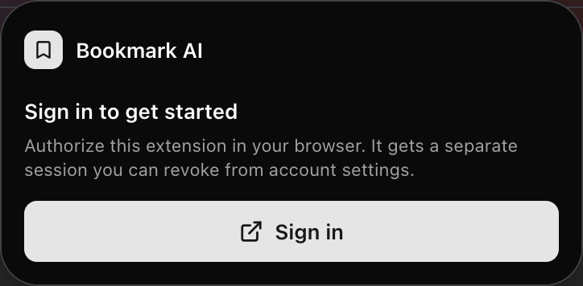
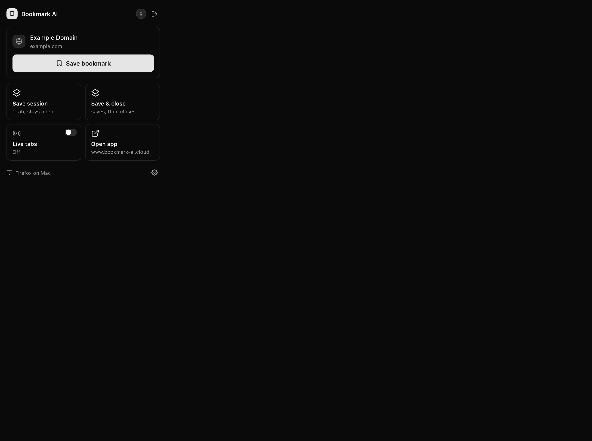

# Firefox production extension QA — 2026-10-09

Production **0.1.6 Supabase authentication, extension callback, save, and canonical web/API read: PASS**. The sign-in request came from the actual toolbar popup. Saving used the separately authorized full-tab extension view, so this does not establish a mouse-driven toolbar save or an AMO-signed installation.

## Exact tested release

- Firefox157.0.1 arm64; original extension ID `bookmark-ai@bookmark-ai.cloud`, MV2, version0.1.6.
- Loaded `apps/extension/.output/firefox-mv2` using official web-ext10.7.0 and only the disposable `.work/production-oct9/firefox-production-profile`.
- Every loaded file matched `dist/production/ARTIFACTS.json` before and after QA.
- Delivered `dist/production/firefox.zip` SHA256: `aedda812debdf1b981124f2eb5817bfd080c15af55ccd8952f1877da8952ec29`.
- Frozen source SHA256: `cd5544447139d1ac550dbb7c2b4f240531386c8e7abf0b898fdae421945aed9c`.
- Observed identity redirect: `https://bbf8f95c67aba661548c23a9abdd835bdefe81a3.extensions.allizom.org/`.
- Official Selenium4.50.0/geckodriver0.37.1 installed under the ignored run directory. Mozilla arm64 archive SHA256 `d02b3f7003f999caf90974a2ef5da0286c05d01cee19112c86846d759fdba4f5` matched its official release digest.

## Observed journey

1. Preserved the existing QA profile before its scoped relaunch. The client stopped its owning web-ext session with Ctrl-C; no personal Firefox process was quit.
2. Started only that profile with process-local `MOZ_REMOTE_ALLOW_SYSTEM_ACCESS=1`, Marionette on loopback2830, and no certificate/security exceptions. The driver asserted its returned profile path before interaction.
3. In Firefox chrome context, clicked Extensions and the installed Bookmark AI action. Its real signed-out popup was observed. Standard WebDriver frame switching could not enter its remote browser.
4. `browserElement.click()` followed by `send_keys(Tab, Enter)` on the actual popup browser opened the hosted production sign-in window. Privately entered the existing disposable fixture through normal email/password inputs. Observed canonical `/oauth/consent`, clicked **Authorize extension**, and observed the provider window close through the Firefox identity callback.
5. The extension then rendered authenticated account/save controls. No token, storage, pending-state or sender admission was injected or altered.
6. Opened a unique owned Example Domain page. Loaded the observed extension popup URL in a background tab while the article remained active, waited for capture, then selected the view. Verified Example Domain, example.com and enabled **Save bookmark** before clicking it. This was full-tab DOM save evidence.
7. Canonical `https://www.bookmark-ai.cloud/app` displayed exactly one link matching the owned URL. A separate private fixture observer read the canonical production API: HTTP200, exactly one matching row, ID `49e6f202-3d4a-4f90-a915-41e5020ff985`, fixture `ff72e211-2733-4333-b983-b065fc8be9cc`.
8. Stopped the test driver and its own web-ext runner. Preserved the QA profile, backup and fixture records as requested.

Owned URL: `https://example.com/?qa-firefox-oct9=1791539745294`.

## Limits and failure alternatives

- CUA Firefox binding repeatedly timed out. Official geckodriver independently worked; this was not an automatic approval rejection.
- Native AX traversal returned macOS assistive-access denial(-1719). That path stopped; no TCC, signature, certificate or global security bypass was used.
- Opening popup.html as a tab for Sign In correctly failed the existing `sameExtension && !sender.tab` admission rule. The actual popup keyboard route succeeded without changing it.
- Standalone official WebDriver BiDi attached and operated browser chrome, but its ordinary realm tree excluded the remote extension popup. It was unnecessary for the successful final route.
- No Google/Apple completion, native bookmark sync, Live toggle/change, incognito grant, cold browser auth persistence or AMO-signed installation was tested here. No owner profile/data changed; incidental desktop imagery was discarded and is not retained as QA evidence.
- This release gate is independent of the separately investigated account-wide Live setting. Live controls were left untouched.

See [the runbook](../RUNBOOK.md#firefox-official-driver-fallback) for the verified portable method. Primary documentation: [Mozilla driver flags](https://firefox-source-docs.mozilla.org/testing/geckodriver/Flags.html), [Mozilla process-local access/security](https://firefox-source-docs.mozilla.org/remote/Security.html), [Selenium Firefox controls](https://www.selenium.dev/documentation/webdriver/browsers/firefox/), [official web-ext profile arguments](https://extensionworkshop.com/documentation/develop/web-ext-command-reference/).
